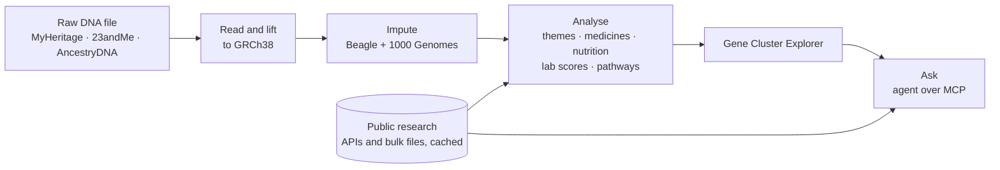

# DNA-Analyzer

**Read your own consumer DNA test against the public research, on your own computer.**

DNA-Analyzer turns the raw data file from MyHeritage, 23andMe or AncestryDNA into the **Gene Cluster Explorer**: an app
that shows what the person's genome means for health themes, medicines, nutrients, lab values and gene pathways, with
every finding traced to the study or database it comes from. A built-in research agent, **Ask**, answers questions in
plain language. The DNA file never leaves the machine.

<br clear="left">

## Highlights

- **From a chip to a genome.** A consumer test measures about 600,000 positions; imputation against the 1000 Genomes
  high-coverage panel (3,202 people, GRCh38) fills in millions more, each with a confidence tier that says how far to
  trust it.
- **Organised by mechanism, not by gene list.** Health themes (cancer, female and male fertility, mind, muscle) are
  networks of genes grouped by what they do, coloured by the person's own results.
- **Every fact has a source.** Effects, frequencies, pathways and citations are fetched from public sources (UniProt,
  ClinVar, the GWAS Catalog, ClinPGx and CPIC, GTEx, Reactome, Europe PMC, Open Targets and more), never written by a
  language model.
- **Private by design.** Analysis runs locally. Public sources are asked by gene symbol or rsID, never by the
  person's variants, and the analysis can run fully offline from a bundled research cache.
- **Ask, an agent over MCP.** Questions are answered by the user's own Claude model working through 27 tools, with
  every citation and figure checked against what the tools returned before anything is shown.
- **A desktop app.** A Windows installer and a Linux tarball, in English and Swedish.

## What the explorer shows

| Tab | What it covers |
|---|---|
| **Home** | A guided introduction: how a DNA test becomes a genome, how to read a cluster, the person's own data at a glance |
| **Clusters** | The health themes as gene networks, each gene coloured by the person's call, with the studies behind it; nutrition within each theme |
| **Medicines** | Drug-gene results: star alleles, CPIC dosing guidelines and ClinPGx annotations for the person's genotypes |
| **Gene pathway** | A gene's chemical lifecycle step by step (Reactome): what each step takes in and gives out, and where the person's variants act |
| **Biomarkers** | Lab values and nutrients as a report: genetic scores placed against 1000 Genomes Europeans, with what moves them |
| **Ask** | Questions in plain language, answered from the person's results and the research, live and checked |
| **Sources** | Every database and API the explorer draws on, with what each one contributes |

The explorer speaks in risk and evidence: what a genotype means for a risk, an exposure or a response, and what the
studies show. It does not give clinical advice.

## How it works



Each step is its own package, and the steps only meet through files: a package can be replaced or run elsewhere
without touching the others. Details in [docs/architecture/](docs/architecture/README.md).

## Privacy

- The DNA file, the imputed calls and every result stay in the app's data folder on the person's computer.
- Public sources are queried with public identifiers only (a gene symbol, an rsID, a drug name), never with a list that
  depends on the person's genotypes. With the bundled research cache, the analysis needs no network at all.
- Ask's model is the user's own (their Anthropic API key or Claude login). What it receives is the user's choice: by
  default, interpreted results for the items a question touches; never the DNA file.
- The app's menu deletes one person or everything personal; the installer asks before removing data on uninstall.

## Getting started

### The desktop app

Build the installer from the repository (Windows: Inno Setup; Linux: a tarball):

```bash
python scripts/build_desktop.py --release --installer                  # Windows setup.exe
python scripts/build_desktop.py --release --installer --target linux   # Linux tarball
```

Install, start it from the desktop icon or the Start menu, and add a person from their raw DNA file. The app opens in
its own window and stops by itself when its window is closed. See
[docs/architecture/production.md](docs/architecture/production.md).

### From source

```bash
pip install -r requirements.txt                    # global Python 3.10+, no virtual environment
python -m genome.references status                 # which reference files are present (genome/references.json)

# put the DNA file in data/input/ and add a profile to cluster_analysis/profiles.json
python -m genome.impute data/input/<file>.csv      # Beagle with the 1000 Genomes panel; Java 11+
python -m cluster_analysis.profiles run            # per-profile analysis (cached)
python -m cluster_analysis.explorer export         # datasets -> data/output/explorer_GRCh38/datasets/
python -m cluster_analysis.explorer serve          # the explorer, with "Add a person" for the whole pipeline
python -m cluster_analysis.explorer check          # renders every tab, profile and language
```

### Docker

`Dockerfile` and `compose.yaml` run the explorer with Python and Java, with the data and the reference panel mounted
from the host; personal data never goes into the image.

## Ask, MCP and OAuth

Ask is a tool-using agent with the rules on the engine's side: the model plans and calls tools; the tools, the privacy
rules and the answer checks live in [cluster_analysis/agent/](cluster_analysis/agent/). Cheap models do the bulk work
and the conversation runs on a mid-size one (tiered inference), with prompt caching keeping a typical question to a few
cents.

```bash
python -m cluster_analysis.agent mcp       # all 27 tools over stdio, for a client on the same machine
                                           #   claude mcp add dna-research -- python -m cluster_analysis.agent mcp
python -m cluster_analysis.agent remote    # the 13 public research tools over HTTP, protected by OAuth 2.1
```

`remote` follows the MCP authorization specification (OAuth 2.1 with PKCE, Protected Resource Metadata, dynamic client
registration, resource indicators) with a built-in sign-in or an identity provider such as Microsoft Entra ID, Auth0,
Amazon Cognito, Keycloak or Google. Only public research tools are served: nothing about anyone's genome is reachable
through it. Details in [docs/architecture/agent.md](docs/architecture/agent.md).

## Project layout

```
genome/              reading DNA files (23andMe, AncestryDNA, MyHeritage), lifting to GRCh38, imputation and
                     confidence tiers, lite mode (measured calls only), the reference manifest
cluster_analysis/    the analysis, one package per feature, each writing its own outputs
  themes/              theme graphs and their cross-reference with the person's DNA (Clusters)
  evidence/            how a variant changes its gene: function evidence, gene calls, literature
  medicines/           drug genes, star alleles, guidelines and drug labels (Medicines)
  nutrition/           nutrients, lab tests, fitness and cancer risk scores (Biomarkers, Clusters)
  lifecycle/           a gene's chemical lifecycle (Gene pathway)
  agent/               Ask: the agent, its tools and checks, the MCP server and the remote MCP server with OAuth
  explorer/            the page (one part per tab), the dataset export, the build and the local server
  knowledge.py         the research cache bundled with the app, for offline use
  pipeline.py          adding a person end to end: check, impute, analyse, load into the explorer
scripts/             the desktop build and launcher, reference downloads, imputation-pack tooling
tests/               unit and end-to-end tests
docs/architecture/   how it fits together, one page per part
```

## Documentation

- [docs/architecture/](docs/architecture/README.md): the whole system and one page per part (imputation, sources,
  themes, evidence, medicines, nutrition, the explorer, Ask)
- [docs/architecture/agent.md](docs/architecture/agent.md): Ask, its tools and checks, the MCP and OAuth servers
- [docs/architecture/production.md](docs/architecture/production.md): the desktop app, the installers, the research
  bundle, imputation without the full panel, and the plan for phones
- [cluster_analysis/README.md](cluster_analysis/README.md) and [cluster_analysis/explorer/README.md](cluster_analysis/explorer/README.md)
- [docs/KNOWN_ISSUES.md](docs/KNOWN_ISSUES.md): open issues
- [docs/outreach/](docs/outreach/): an overview of Ask for partners and investors

## Status

Version 0.1.9. The analysis, the explorer, Ask and the Windows installer run end to end. In progress: shipping the
compact imputation panel in the installer (so every install imputes without the 12 GB reference panel), testing the
Linux build, a phone version that keeps the DNA on the phone, and hosting the remote MCP server.

## Contributing

Run the tests with `python -m unittest discover tests`. The repository is public: never commit DNA files, genotypes or
anything derived from a person (`data/input`, `data/output`, `data/reference` and `cluster_analysis/cache` are ignored
by git). Facts come from sources, not from a language model: curated configs only choose which genes, tests and traits
to use.
