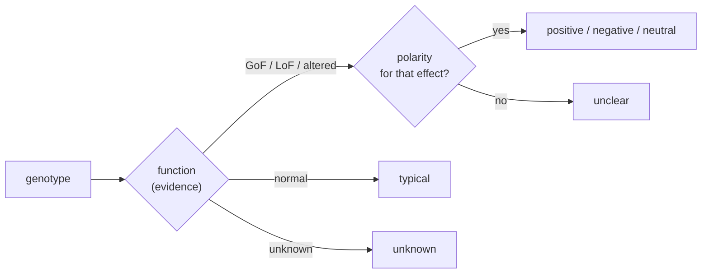

# Architecture

This page covers the PDF report. The cluster analysis (imputation, themes, evidence calls, medicines and the Gene
Cluster Explorer) is described with diagrams in [architecture/](architecture/README.md).

## Input format

The current MyHeritage exports (`##format=MHv1.0`) come from **low-pass whole-genome sequencing plus imputation**, reported on the **forward (+) strand, GRCh37**:

```
RSID,CHROMOSOME,POSITION,RESULT        # ~585k rows, chr 1–22 + X (no Y / MT)
"rs4477212","1","82154","AA"
```

- Every row is a 2-letter call. There are no `--` no-calls, because missing positions are imputed. Rare-variant calls are less reliable than common ones.
- Heterozygotes appear in both orders (`AG` and `GA` are about equally frequent), which is why the matcher must sort them.
- A few RSIDs appear twice. `load_dna_file` keeps the last one.
- Because the input is forward-strand, the complement fallback only exists to rescue `snp_traits.json` entries that were written on the reverse strand.

Of the 229 traits, ~183 are present in a typical file. The rest aren't on MyHeritage's panel.

## Data flow

```
data/input/X.csv
      │
      ▼
src/loader.py          load_dna_file()     → {rsid: "AG", ...}   (~600k SNPs)
      │
      ▼
src/analyzer.py        run_analysis()      for each rsid in config/snp_traits.json:
      │                   src/normalizer.resolve_genotype()   (sort + strand-flip match)
      │                   src/domain_mapper.map_system_to_domain()
      │                → DataFrame: RSID, Gene, System, Domain, Trait, Impact, Result,
      │                             User_Genotype, Function, Outcome, Basis, Interpretation,
      │                             Function_Map, Polarity, Variant_Map
      ▼
main.py                clean_domain_names() → short labels ("Cardio", "Brain", ...)
      │                groupby Domain → Positive / Baseline / Negative / Net
      │                src/visualizer.create_polar_chart()  → polar_chart.png
      │
      │                ReportEngine(language)   loads [SV_]deep_dive_content.json, [SV_]evidence_db.json
      │                PDFReport(labels=...)     FPDF subclass, all drawing code
      ▼
      PDF: intro (4p) → dashboard → active traits → strengths → risks → heritage
```

The relatives' files go through `run_analysis()` the same way. `src/inheritance.analyze_inheritance()` then merges them with the primary subject's results on RSID.

## Modules

| File | Responsibility |
|---|---|
| `src/loader.py` | Reads CSV/TSV with `#` comments, auto-detects the separator, and requires `RSID` and `RESULT` columns. Returns a dict. |
| `src/normalizer.py` | `resolve_genotype(user_gt, variants)`: sorts the user genotype alphabetically and tries a direct key match, then a complement-strand match. |
| `src/analyzer.py` | Joins the DNA with `snp_traits.json`, reads each genotype's evidence call and outcome (`outcome()`), and sorts by Domain → Impact rank → positive/negative first. |
| `src/domain_mapper.py` | Keyword rules that map the free-text `system` field to one of 10 domains (or "Other"). **Order matters**: the first rule that matches wins. |
| `src/proxy_handler.py` | Fills a library SNP the file lacks from a co-inherited SNP it has (`config/proxies.json`). Returns the estimates so the report can print a note under "Your Result". |
| `src/inheritance.py` | Compares the child's genotype with each relative's (exact string match) and labels each SNP's source. |
| `src/visualizer.py` | Plotly polar chart (domain balance) and donut chart (heritage), exported to PNG via kaleido. |
| `src/report_engine.py` | `ReportEngine` handles language-aware content lookup. `PDFReport` holds every page layout. `clean_text()` downgrades text to Latin-1 for the core PDF fonts. |

## Reading a result

The library's old 1–10 ratings (written with an LLM) were removed on 2026-11-07. Each genotype is now read in two steps:

1. **Function** (`snp_traits.json → function`): what the genotype does to the gene by the evidence: GoF, LoF, normal,
   altered (changed, direction unknown) or unknown. It comes from `cluster_analysis/evidence_call.py` (CPIC, MaveDB,
   UniProt, a protein cut short, SIFT/PolyPhen, GTEx) and is stored in the library so the report runs offline.
2. **Outcome**: whether that change is good or bad for the person, from the entry's `polarity`
   (`{"LoF": "negative"}`). Positive / negative / neutral; *unclear* when the evidence calls a change but no polarity
   says which way it cuts; *typical* for normal function; *unknown* without evidence.



- Dashboard: Positive and Negative count those outcomes per domain; everything else is Baseline. `Net = Positive − Negative`.
- Active traits: one table of GoF genotypes and one of LoF genotypes, each with its reading (+ / − / 0 / ?).
- Strengths are positive outcomes, risks negative ones. A deep-dive page is rendered when the RSID exists in
  `deep_dive_content.json` with the matching `data_strength` / `data_risk` block; the rest fall back to the summary
  pages (at most 12 each).
- The genotype list on a deep dive is ordered positive → typical → negative and tags each genotype with its call.
- Polarities were first drafted on 2026-11-07 from the old ratings (direction only, never size)
  and the library's wording; `polarity_source` says which, and `"reviewed"` marks one set by hand. See
  [architecture/evidence.md](architecture/evidence.md).
- Before the tables, `unique_df` keeps only the **first SNP per gene** (`drop_duplicates(subset=['Gene'])`).

### Confidence score (evidence panel)

```
confidence = min(5, (mechanistic_impact * 3 + study_quality + methodology) / 5)
```

Each input is a 1–5 score taken from `evidence_db.json → metrics`. When no entry exists, defaults of 3/2/3 are used and the panel is labelled PRELIMINARY.

## Localisation

- `LANGUAGE_CONFIG` in `report_engine.py` maps a language to a file prefix (`""`, `"SV_"`, `"DE_"`).
- Narrative files load from `config/{prefix}deep_dive_content.json` and `config/{prefix}evidence_db.json`.
- UI strings come from `config/ui_labels.json`. The selected language is merged **over** English, so a missing key silently falls back to English.
- Analysis data (trait names, interpretations, domain names in tables) stays in English. Only the PDF chrome and the narratives are translated.
- German is declared in the config, but no `DE_` files exist.

## Matching caveats (important)

- Genotype keys in `snp_traits.json` are **not** normalised. The normaliser sorts the *user's* genotype (`GA` → `AG`) but compares it with the JSON keys exactly as written. A trait that only lists `"GA"` therefore never matches a heterozygote. See KNOWN_ISSUES.
- Strand flipping can't tell the strands apart for palindromic SNPs (A/T, C/G). 23 traits are not yet hand-verified.
- No-calls (`--`) and indels drop out silently. They are not reported as "not tested".
