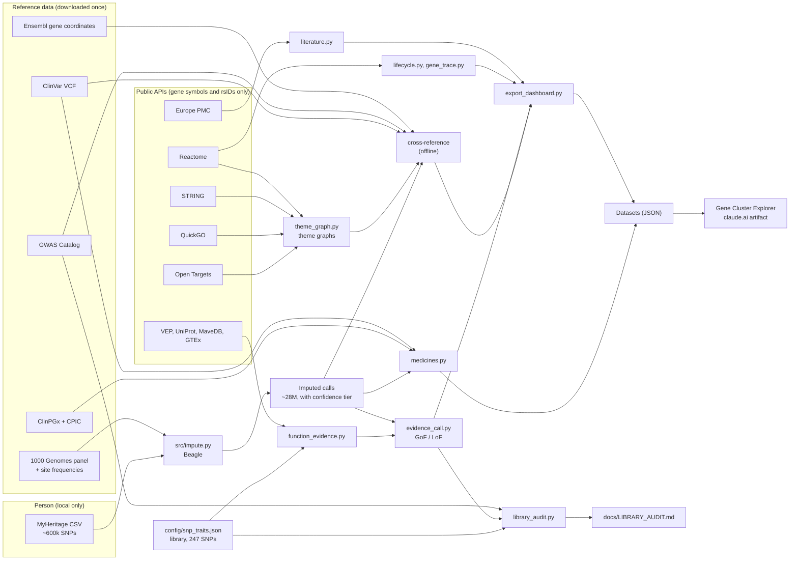
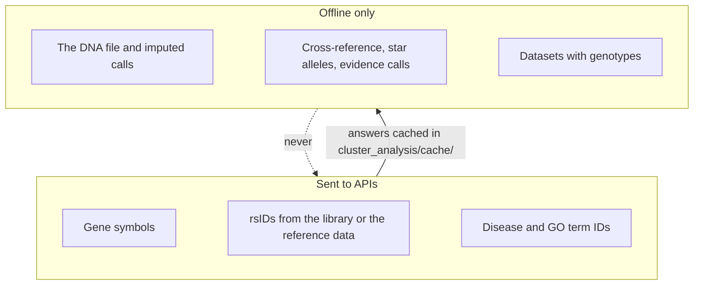
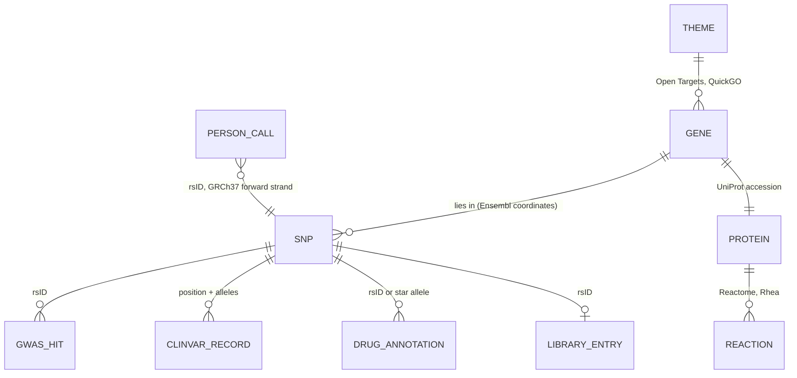

# Cluster analysis architecture

How the gene-cluster side of DNA-Analyzer fits together: from a MyHeritage file, through imputation and public research
data, to the Gene Cluster Explorer. The PDF report has its own page, [../ARCHITECTURE.md](../ARCHITECTURE.md).

| Page | What it covers |
|---|---|
| [imputation.md](imputation.md) | From ~600k measured SNPs to ~28 million calls, and the confidence tiers that say which calls to trust |
| [sources.md](sources.md) | Every external source: what it gives, how we reach it (API or bulk download), and the keys that join them |
| [themes.md](themes.md) | Theme graphs (cancer, fertility, muscle), the DNA cross-reference and what each gene colour means |
| [evidence.md](evidence.md) | Gene function calls from evidence (GoF / LoF), the library audit and its corrections |
| [lifecycles.md](lifecycles.md) | A gene's chemical lifecycle: Reactome steps, cofactors, regulators and papers |
| [medicines.md](medicines.md) | Drug genes, star alleles, ClinPGx annotations, guidelines, drug labels and ClinVar drug response |
| [explorer.md](explorer.md) | The datasets the explorer reads, its tabs, and how a new version is published |

## The whole system

## The privacy boundary

The person's genotypes never leave the machine. Everything that talks to the internet works on public identifiers;
everything that touches a genotype runs offline against local reference files.

- `data/input`, `data/output` and `data/reference` are gitignored. The repo is public, so genotypes and raw files must
  never be committed.
- Datasets with genotypes (`theme_genes`, `gene_function`, `med_*` ...) are published only to the private artifact.
- `sources.py` caches every API answer on disk, so a re-run sends nothing new.

## How the pieces join

Four keys connect every source. A gene symbol links the themes, the library, the lifecycles and the drug genes; an
rsID and its GRCh37 position link a genotype to ClinVar, the GWAS Catalog and ClinPGx.

All positions are GRCh37 and all alleles are on the forward strand, as in the MyHeritage files. Ensembl's REST API
works in GRCh38, so it is only used by rsID, never by position.

## Profiles

| Profile | Whose | Used for |
|---|---|---|
| XY | The user's own DNA | Cancer, male fertility, muscle, lifecycles, medicines |
| XX | Female fertility blueprint | Female fertility |

Other people's files in `data/input` are never published.
