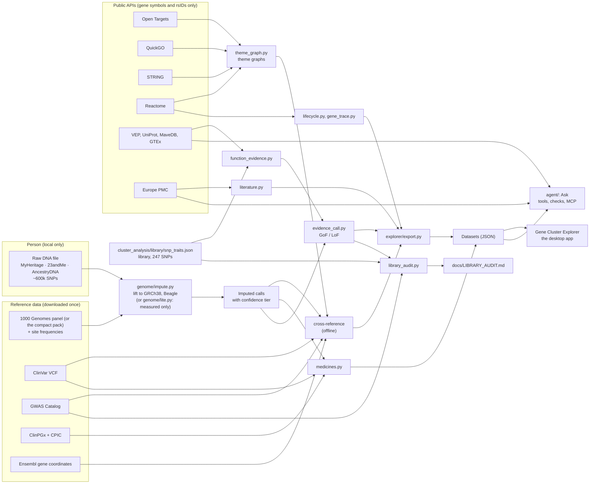
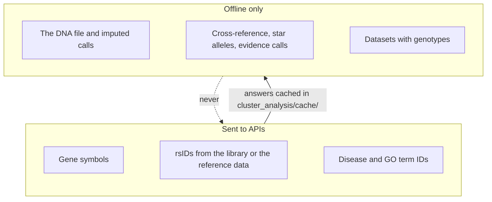
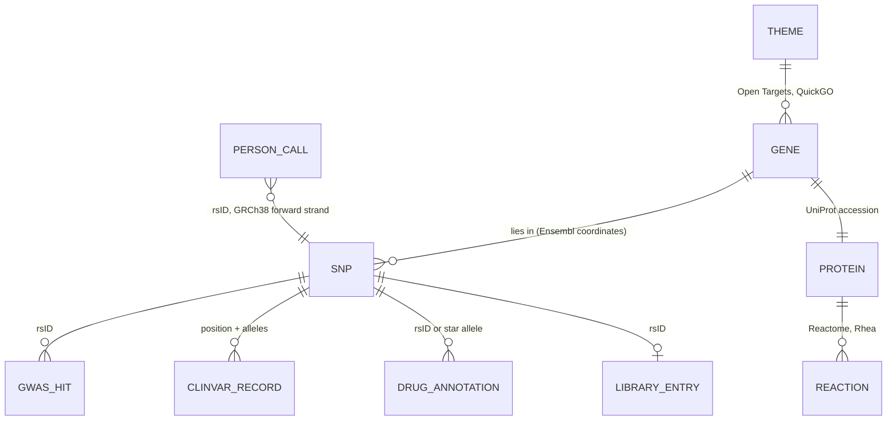

# Cluster analysis architecture

How the gene-cluster side of DNA-Analyzer fits together: from a MyHeritage file, through imputation and public research
data, to the Gene Cluster Explorer.

| Page | What it covers |
|---|---|
| [imputation.md](imputation.md) | From ~600k measured SNPs to tens of millions of calls: the 1000 Genomes high-coverage panel, the compact pack the app ships, lite mode, and the confidence tiers that say which calls to trust |
| [sources.md](sources.md) | Every external source: what it gives, how we reach it (API or bulk download), and the keys that join them |
| [themes.md](themes.md) | Theme graphs (cancer, fertility, muscle), the DNA cross-reference and what each gene colour means |
| [evidence.md](evidence.md) | Gene function calls from evidence (GoF / LoF), the library audit and its corrections |
| [lifecycles.md](lifecycles.md) | A gene's chemical lifecycle: Reactome steps, cofactors, regulators and papers |
| [medicines.md](medicines.md) | Drug genes, star alleles, ClinPGx annotations, guidelines, drug labels and ClinVar drug response |
| [nutrition.md](nutrition.md) | Per nutrient: the uptake and conversion steps, where the person's variants act on them and how, and the net effect on the blood level |
| [inheritance.md](inheritance.md) | A child of an XX and an XY profile: recessive, dominant and X-linked conditions, single-gene traits and drug types as odds, with how far each parent's call can be trusted |
| [explorer.md](explorer.md) | The datasets the explorer reads, its tabs, and how a new version is published |
| [agent.md](agent.md) | Ask: the conversation agent, its 27 tools and answer checks, what the model sees, the research agent, the MCP server and the remote MCP server with OAuth 2.1 |
| [production.md](production.md) | From dev to production: what other people need to run it, and the ways to ship it (Docker, a desktop app, lite mode) |

## The whole system

## The privacy boundary

The person's genotypes never leave the machine. Everything that talks to the internet works on public identifiers;
everything that touches a genotype runs offline against local reference files.

- `data/input`, `data/output` and `data/reference` are gitignored. The repo is public, so genotypes and raw files must
  never be committed.
- Datasets with genotypes (`theme_genes`, `gene_function`, `med_*` ...) stay in the app's data folder on the person's
  computer; the explorer serves them on that computer only. Ask's model receives at most the interpreted results a
  question touches ([agent.md](agent.md)).
- `sources.py` caches every API answer on disk, so a re-run sends nothing new.

## How the pieces join

Four keys connect every source. A gene symbol links the themes, the library, the lifecycles and the drug genes; an
rsID and its position link a genotype to ClinVar, the GWAS Catalog and ClinPGx.

Consumer files are GRCh37; their calls are lifted to GRCh38 when read, and the analysis and every reference file share
that build (`genome/build.py`, `DNA_BUILD`; GRCh37 remains for comparison). Alleles are on the forward strand.

## Profiles

| Profile | Whose | Used for |
|---|---|---|
| XY, XY_1 | The developer's own DNA (consenting) | Cancer, male fertility, muscle, mind, lifecycles, medicines, Ask |
| XX, XX_1 | A consenting participant | Female fertility, and the other themes |
| HG00096 | A public 1000 Genomes sample | Reading formats and running the pipeline end to end; imputation accuracy (it is in the panel, so it is left out of the reference) |

Other people's files in `data/input` are never published.
