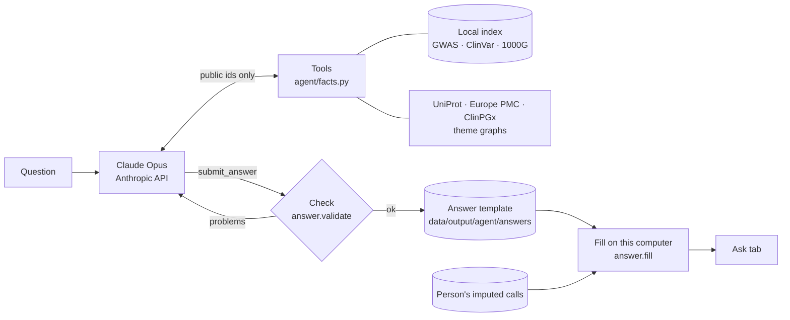

# The research agent (Ask tab)

`cluster_analysis/agent/` answers questions about a person's genome ("Why should I care about this gene?", "What
medicines should I watch out for?") with a language model and the same public sources as the other tabs. It is a
tool-using agent with the rules on the engine's side: the model plans and calls tools; the tools, the privacy rules
and the answer checks live in this package, and run on the person's own computer.

Three ways to answer, from the most used to the least:

| Flow | Code | Model | Used by |
|---|---|---|---|
| **Conversation** | `converse.py`, `tools.py` | Claude Sonnet 5.5 at medium effort (`DNA_AGENT_CONVERSE_MODEL`), or Claude Code with `sonnet` | the Ask tab |
| **Research agent** | `run.py`, `facts.py`, `answer.py` | Claude Opus 5.5, adaptive thinking, effort high (`DNA_AGENT_MODEL`, `DNA_AGENT_EFFORT`) | the command line, MCP clients |
| **Quick answer** | `quick.py`, `terms.py`, `providers.py` | none (rules), with Haiku 5.5 routing the question when a model is connected (`route.py`) | the command line |

Readings of the person's results are written by Haiku 5.5 (`DNA_AGENT_SMALL_MODEL`, `categories.py`, `interpret.py`),
once for everyone, and picked on the computer.

## The conversation (Ask tab)

`converse.ask(question, person, session_id)` runs one turn:

1. **understand.** The model's first call: what it took the question to mean (and what a genome can and can't say
   about it), the aim (`explain`, `strategies`, `research` ...), the areas and strategies it will cover, and a plan.
   Shown at once.
2. **resolve, catalogue.** Names to what the explorer holds: a drug by any name or spelling, a gene, a lab test, a
   condition, a mechanism.
3. **my_\* tools.** The person's own results for the items named, as result cards on the person's screen.
4. **Research.** When local data doesn't answer: `search_papers`, `read_paper`, `research_genotypes` (study sentences
   that name a genotype group and an effect), `recent_papers`.
5. **show_\* tools.** The explorer's views drawn into the answer: a cluster, a pathway, a medicine, a nutrient, papers.
6. **answer.** Summary, highlights, explanation with citations, links for the answer's web, follow-up questions.
   Checked (below); sent back with every problem at once if it fails.
7. **Readings.** On the computer: the readings for the person's result cards and study findings, picked from those
   written for everyone (`categories.py`, `interpret.py`).
8. **Saved.** The turn goes to `data/output/agent/sessions/<id>.json`; a follow-up continues the conversation.

### The tools (`tools.py`)

Four kinds, by what goes back to the model:

| Kind | Tools | The model gets |
|---|---|---|
| public (13) | `catalogue`, `resolve`, `gene`, `variant`, `cluster`, `trait_variants`, `drug`, `research_genotypes`, `search_papers`, `read_paper`, `pathway`, `nutrient`, `recent_papers` | the full result: facts that are the same for everyone (UniProt, GWAS Catalog, ClinVar, ClinPGx, CPIC, Europe PMC, Reactome). Every ref and text goes into the turn's ledger |
| personal (7) | `my_medicine`, `my_medicines`, `my_scores`, `my_cluster`, `my_gene`, `my_condition`, `my_nutrient` | the result's shape (what kinds of data are on the screen, how many), plus the interpreted results when sharing is on |
| view (5) | `show_cluster`, `show_pathway`, `show_medicine`, `show_nutrient`, `show_papers` | "shown" |
| control (2) | `understand`, `answer` | the plan is shown; the answer is checked |

Every call is validated against its schema before it runs, counted against the lookup budget (10 public or personal
lookups a turn, 20 when the aim is strategies or research), and recorded in the turn's trace for the tab. A tool result
is cut to 24,000 characters (`facts.clip`, empty fields dropped, compact JSON).

### What is sent

Ask needs a model, and connecting one is the user's own setup: their Anthropic API key, or their Claude Code login.
What that model receives is therefore their decision too, set in the AI corner of the Ask tab (`agent/settings.py`,
`data/output/agent/settings.json`):

| `share_results` | The model receives | The summary |
|---|---|---|
| on (default) | the question; the public research the tools return; and, for the items the question touches, the person's interpreted results: a gene's type ("CYP2C9 \*1/\*1, normal metaboliser"), a score's band and which way is better ("homocysteine: top 10%, higher is worse"), the genotype a finding applies to ("PTGS2 rs20417 CC") | written by the model, weaving the person's results and the evidence together |
| off | the question and public research only; personal tools return just the kind of result shown | the model's general explanation; the person's readings are added on the computer |

Never sent, in either mode: the DNA file, raw genotypes outside the items a question touches, the person's name or
profile id. Searches are built from public names only (a drug, a gene, a condition the question named), never from a
list that depends on the person's genotypes. Public tools never read personal data (`tests/test_agent.py`).

A follow-up sends the earlier questions, the readings and plans, the tool calls with their public arguments and the
model's own explanations (`session.context`), never the person's results or anything shown only on their screen. The
ledger carries over, so a paper cited earlier isn't fetched again.

Anthropic's handling of API and Claude Code data is set out in its own terms; by default it doesn't train on it.

### The answer check (`tools.t_answer`)

| Check | Rejects | |
|---|---|---|
| Summary | an answer without a 2-4 sentence summary | hard |
| Research done | a strategies answer before two outward lookups, or with a listed strategy not yet searched | hard |
| Ranks | a rank the question didn't ask about, or written the wrong way round (`language.rank_problems`) | hard |
| Advice | anything that reads as clinical advice (`language.advice`; the user's rule: risk and evidence, never advice) | hard |
| Areas read | an answer that skips areas its own plan listed | soft |
| Citations | a ref no tool returned in this conversation | soft |
| Highlights | a figure not found in its cited source, or not in the person's result it names | soft |
| Links | a web link without its area, genes, refs or finding | soft |

Hard problems always send the answer back. Soft ones send it back up to twice (`MAX_REJECTIONS`); after that the answer
is kept with the unsupported citations and highlights removed and listed as dropped.

### Engines (`converse._engine_api`, `converse._engine_cc`)

| Engine | When | How |
|---|---|---|
| API | an API key is set (the Ask tab, `ANTHROPIC_API_KEY`, or the remembered key) | the Messages API in a hand-written loop: 16 steps at most, 8,000 output tokens a step, prompt caching on (`cache_control`), effort medium. Each tool result is recorded in the ledger and reported to the tab; a failed check goes back as a tool error. With `DNA_AGENT_PTC=1` (prototype) the model can run independent lookups together in a script inside Claude's code execution (programmatic tool calling) |
| Claude Code | no key, and the Claude Code command line is found (`claude` on PATH, `DNA_CLAUDE_CLI`, or the VS Code extension's copy) | `claude -p` with no built-in tools and only this package's tools over MCP (`--strict-mcp-config`, `--permission-mode dontAsk`), on the user's Claude plan. The MCP server shares the turn through `DNA_TURN_FILE`, so the person's results reach the tab without passing through Claude |

## The research agent (`run.py`)

The earlier, stricter design, kept for the command line and MCP clients. The model never sees a genotype. It researches
from public facts only and writes its answer as a **template**: for each variant it picks, what carrying 0, 1 or 2 copies
of the effect allele means for the question. Then this computer reads the person's calls for those variants and shows
the reading that applies (`answer.fill`), with no network call. Templates don't depend on the person, so one run serves
every profile.

`answer.validate` checks the answer against the ledger of everything the tools returned; failures go back to the model as
a tool error, up to 5 times:

| Check | Rejects |
|---|---|
| Variants | an rsID not looked up with `variant()`, one with no 1000 Genomes alleles, or an effect allele that isn't one of the two (with a hint when it is on the other strand) |
| Readings | anything but exactly one reading each for 0, 1 and 2 copies; a `lean` that isn't one of the answer's axes |
| Sources | a ref id (`PMID:…`, `GWAS:GCST…`, `ClinVar:…`, `ClinPGx:…`, `UniProt:…`, `Theme:…`) no tool returned |
| Quotes | text that is not word for word in what a tool returned for that source |
| Figures | a percentage or fold change that is in none of the texts of the sources its sentence cites |
| Advice | a `when` condition on a variant that isn't in the answer |

Its tools (`facts.py`): `themes`, `theme_genes`, `gene`, `variant`, `trait_variants`, `search_papers`, `read_paper`. The
loop streams the Messages API with adaptive thinking (summaries shown live), runs up to four tool calls in parallel
(`ThreadPoolExecutor(4)`), uses server-side fallbacks for declined requests, and stops at 40 steps. Every step is logged
with a timestamp in `data/output/agent/runs/<id>.jsonl` (no personal data: the question, the tool calls, the model's
text).

## The public index

Bulk lookups use `cluster_analysis/cache/agent_index.sqlite`, built from public files: `gwas_associations_ontology.zip`,
ClinVar and the panel site list (`python -m cluster_analysis.agent index`, a few minutes, about 470 MB, ignored by git;
`index --vep` adds the variants earlier Ensembl VEP runs cached). Lookups that need the network (UniProt, Europe PMC,
ClinPGx, Open Targets, Reactome) are cached in `cluster_analysis/cache` like the other packages' lookups, and most ship
with the app's knowledge bundle.

## Models by job (tiered inference)

| Tier | Model | Jobs | Measured cost (API prices) |
|---|---|---|---|
| 0 | none | matching names, result cards, every answer check | $0 |
| 1 | Haiku 5.5 | readings for every possible result, written once and cached; routing quick answers | fractions of a cent per batch, once |
| 2 | Sonnet 5.5, medium effort | the conversation | about $0.07 a question (recorded turns) |
| 3 | Opus 5.5, adaptive thinking | the research agent | about $1 a question (recorded runs) |

Token use is held down by prompt caching (in recorded turns nearly all input was read from the cache), compact tool
results, the lookup budget, short follow-up context, and readings written once for everyone. `cost.py` records each
turn's tokens split as billed (fresh input, cache read, cache write, output) and its API price, shown in the tab; on a
Claude Code login the tokens count against the plan instead.

## Concurrency

- **The question** runs as a background job in the server (`server.Agent.converse`); asking returns a job id at once
  and the page polls `/api/agent/events?job=J&after=N`, drawing each event as it comes: the plan, each tool call, the
  sources in use, the running token count.
- **The server** is a `ThreadingHTTPServer`: the page and its data are served while a question runs.
- **Claude Code** runs as its own process and the tools as another (the MCP server); they share the turn through a file.
- **Readings** are written in batches, four at a time; quick answers search studies six at a time; the research agent
  runs up to four tool calls at once.
- In the conversation engine, the tool calls of one model step run in order: they are local and take milliseconds.

## The MCP server (`mcp_server.py`)

`python -m cluster_analysis.agent mcp` serves the tools over stdio. The Ask tab starts Claude Code with it; any other MCP
client can use it the same way. For Claude Code: `claude mcp add dna-research -- python -m cluster_analysis.agent mcp`
from the repo root. Used on its own (no `DNA_TURN_FILE`), `DNA_PERSON` names the profile the personal tools read; their
results are kept in `data/output/agent/mcp_turn.json`. The answer check runs inside the server's `answer` (and
`submit_answer`) tool, so it holds whichever model is connected. MCP clients don't enforce the answer schema, so
`answer.shape` checks it as part of the validation.

## The remote MCP server, with OAuth 2.1 (`remote.py`)

`python -m cluster_analysis.agent remote [--host 127.0.0.1] [--port 8765] [--public-url URL]` serves the **public**
tools (`tools.PUBLIC`: genes, variants, clusters, drugs, papers, pathways, nutrients) over Streamable HTTP at `/mcp`,
for MCP clients on other machines. No personal tool, no view and no person sits behind it, so nothing about anyone's
genome can be reached through it; each call gets a fresh context (its own lookup budget and ledger).

It follows the MCP authorization specification:

- **Discovery.** An unauthenticated request gets 401 with a `WWW-Authenticate` header pointing to the OAuth Protected
  Resource Metadata (RFC 9728, `/.well-known/oauth-protected-resource/mcp`), which names the authorization server.
- **Tokens** need the scope `dna.research` and must be issued for this server's own URL (RFC 8707 resource
  indicators, `validate_token_resource`).
- **Built-in sign-in** (default): an authorization server in the process, from the MCP SDK's
  `OAuthAuthorizationServerProvider`. OAuth 2.1 with PKCE (S256), dynamic client registration (RFC 7591), a sign-in page
  at `/login` guarded by `DNA_OAUTH_PASSWORD` (a random one is printed when unset), single-use codes (5 minutes),
  access tokens for an hour, rotating refresh tokens for 30 days, revocation. Tokens live in memory: a restart signs
  everyone out. Meant for demos and one operator.
- **External identity provider:** with `DNA_OAUTH_ISSUER` and `DNA_OAUTH_JWKS_URL` (and `DNA_OAUTH_AUDIENCE`, default
  the server's `/mcp` URL) the server is a resource server only and accepts JWTs from that provider (Microsoft Entra ID,
  Auth0, Amazon Cognito, Keycloak, Google), checked against its published keys, issuer, audience and expiry.

`tests/test_remote_mcp.py` runs the whole flow against a real server: discovery, registration, PKCE, sign-in, the token
exchange (and that a code works once), an MCP session with the bearer token listing exactly the public tools, and the
refusal of a wrong password and of a made-up token.

## The key

The loop takes it from `ANTHROPIC_API_KEY`, or from `data/output/agent/api_key`, which the Ask tab writes when
"remember" is ticked: encrypted with DPAPI for the Windows user, or mode 600 on Linux (protected by file permissions
only; `agent/keystore.py`, which also rewrites an older plain-text file encrypted). Otherwise the server keeps it in
memory. No endpoint returns it: the status says only whether one is set.

## Where it runs

- **Ask tab:** `explorer serve`, with the routes under `/api/agent/*` in `explorer/server.py`; the page parts are
  `explorer/ask.*`. One question runs at a time.
- **CLI:** `python -m cluster_analysis.agent ask "QUESTION" --person <profile>` (research agent), `quick`, `fill`,
  `list`.
- **MCP:** `python -m cluster_analysis.agent mcp`.

## Files

| Path | In git | Holds |
|---|---|---|
| `cluster_analysis/agent/*.py` | yes | the package |
| `cluster_analysis/cache/agent_index.sqlite` | no | the public index |
| `cluster_analysis/cache/` | no | public lookups, and the readings written for everyone |
| `data/output/agent/sessions/` | no | conversations: questions, plans, tool calls, results shown, answers (personal) |
| `data/output/agent/answers/` | no | the research agent's answer templates (no genotypes, but the user's questions) |
| `data/output/agent/fills/` | no | the research agent's per-person readings (personal) |
| `data/output/agent/runs/` | no | the research agent's step logs |
| `data/output/agent/api_key` | no | the remembered key (encrypted on Windows) |
