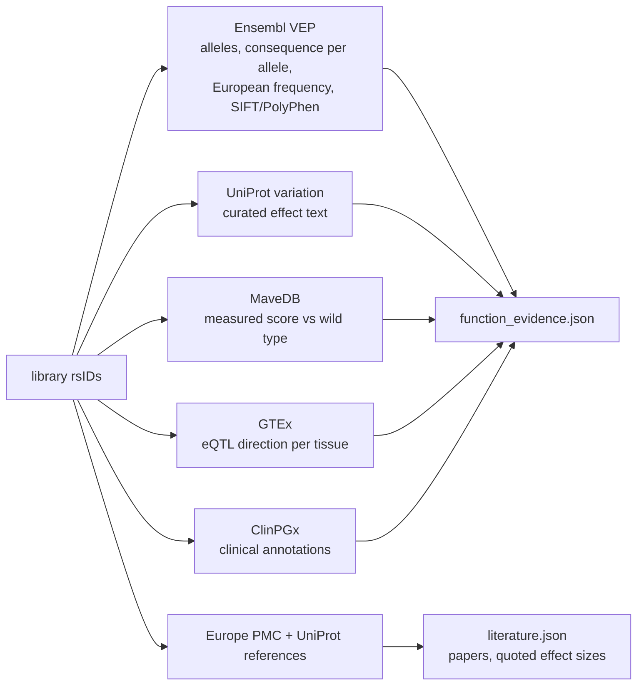
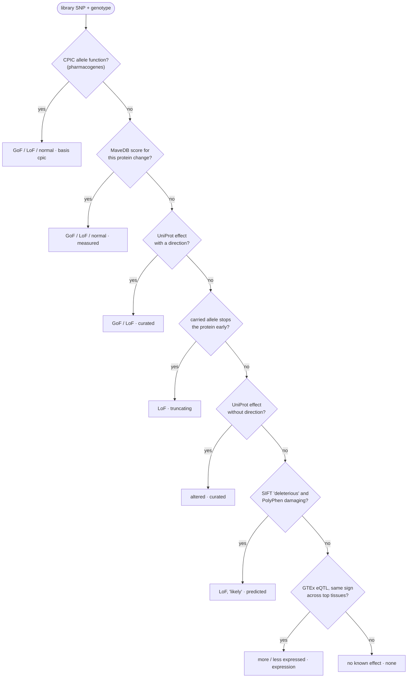
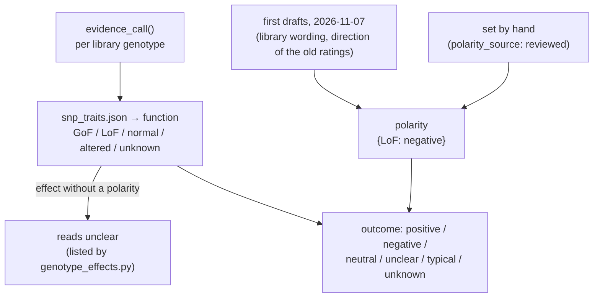
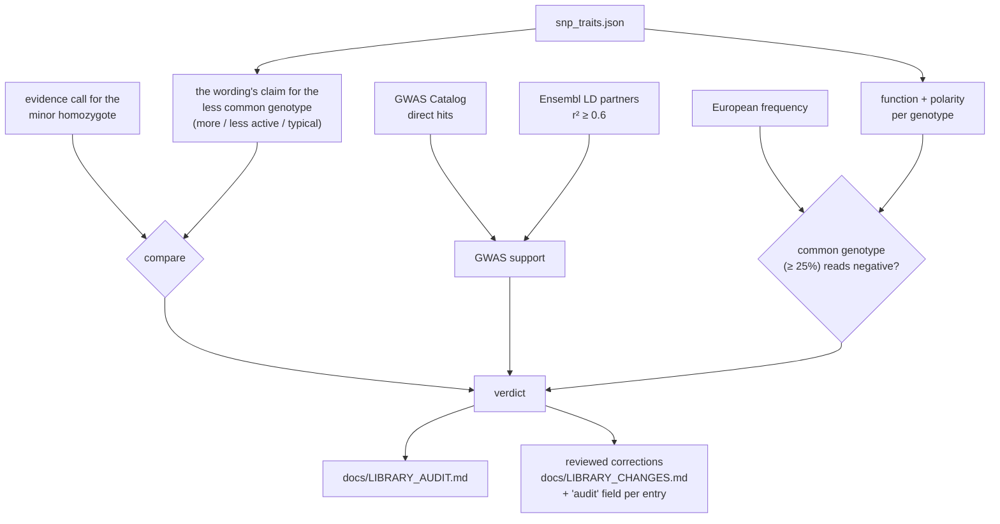

# Gene function calls and the library audit

The library (`config/snp_traits.json`, 247 SNPs) was written with an LLM. Its sentences say what a genotype means for a
trait, but they are not evidence of what the variant does to the gene. The explorer's labels therefore come from
evidence about the variant, and the library itself is checked against that evidence.

## Gathering evidence



## The evidence ladder

`evidence_call.py` takes the strongest evidence available for the person's genotype:



Details that matter:

- **Protein effects** count copies of the changed allele, relative to the standard protein: COMT Met is the
  low-activity allele however common it is.
- **Expression effects** are relative to the common genotype: if the common allele lowers expression, carriers of the
  other allele are the more expressed ones.
- **Truncation is allele-specific.** A rare third allele that is a stop codon doesn't make a common missense change
  "truncating" (ADRB2 rs1042714).
- **UniProt text** only counts its function parts: in "low enzyme activity; may increase the tendency to develop
  hypertension" the first part decides.

The library's wording-based call is kept as `library_function` for comparison, and the explorer marks the library
sentence as a note written with an LLM.

## From the call to positive or negative

The report and the explorer read each genotype as positive or negative for the person in two steps: the evidence call
above says what the genotype does to the gene, and the library entry's `polarity` says whether that is good or bad.
The call is evidence; the polarity is a best-effort reading of the trait.



- The first drafts compared the old rating of the genotype carrying the most copies of the effect with the genotype
  carrying none: a gap of 2 or more decided the direction, a smaller one made it neutral. Only the direction was used,
  and the ratings were then removed. New polarities are set by hand.
- Where the library's wording names a function the evidence reverses (it says more active, the protein evidence says
  less), the draft kept the library's view of which function is good and flipped the sign. Where the evidence is tissue
  expression only, neither side was strong enough, and the effect got no polarity: it reads *unclear*.
- Protein evidence is put on the allele that codes the changed residue. GRCh38 sometimes carries the rarer form
  (PTPN22 rs2476601 holds Trp620; UniProt's standard protein has Arg620), so the allele is matched by amino acid, not
  taken to be the genome's alternative allele.
- A lost start codon is not counted as cutting the protein short: translation can restart at a later ATG (VDR FokI
  gives a shorter, more active receptor).

```bash
python -m cluster_analysis.genotype_effects           # calls that would change, and effects without a polarity
python -m cluster_analysis.genotype_effects --write   # write function / function_basis into the library
```

## The library audit



| Verdict | Meaning |
|---|---|
| contradicts | The wording's direction is the opposite of the evidence |
| unsupported | No functional evidence and no genome-wide study, yet the wording claims an effect |
| common genotype reads negative | Most Europeans carry a genotype that reads negative |
| no polarity | The evidence calls a change but nothing says whether it is good or bad |
| function claim unsupported | The trait has GWAS support; the activity wording doesn't |
| agrees / no function claim | Nothing to change |

```bash
python -m cluster_analysis.function_evidence    # gather (API, cached)
python -m cluster_analysis.library_audit        # → docs/LIBRARY_AUDIT.md, library_audit.json
```

The audit never edits the library. Corrections are made after review and listed in `docs/LIBRARY_CHANGES.md`; the
library also drives the PDF report, so a change there changes the report.
