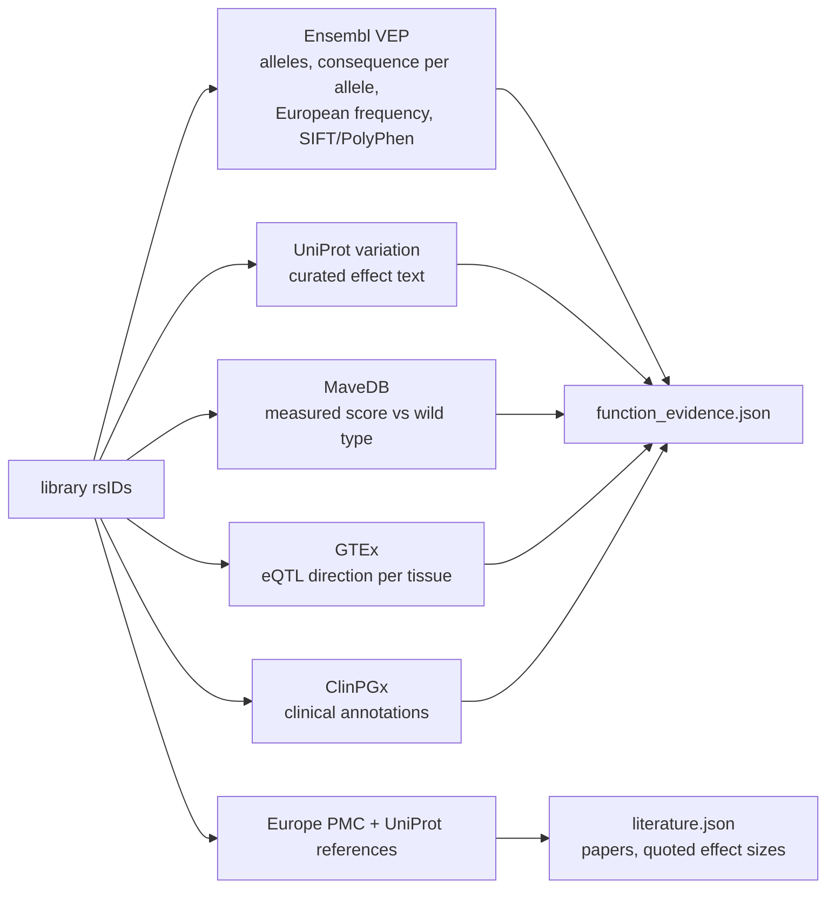
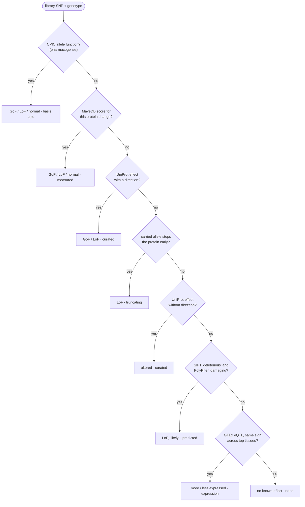
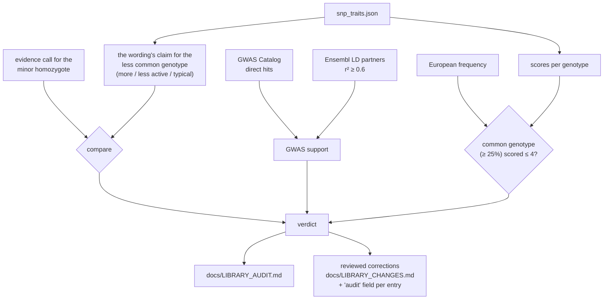

# Gene function calls and the library audit

The library (`config/snp_traits.json`, 247 SNPs) was written with an LLM. Its sentences say what a genotype means for a
trait, but they are not evidence of what the variant does to the gene. The explorer's labels therefore come from
evidence about the variant, and the library itself is checked against that evidence.

## Gathering evidence



## The evidence ladder

`evidence_call.py` takes the strongest evidence available for the person's genotype:



Details that matter:

- **Protein effects** count copies of the changed allele, relative to the standard protein: COMT Met is the
  low-activity allele however common it is.
- **Expression effects** are relative to the common genotype: if the common allele lowers expression, carriers of the
  other allele are the more expressed ones.
- **Truncation is allele-specific.** A rare third allele that is a stop codon doesn't make a common missense change
  "truncating" (ADRB2 rs1042714).
- **UniProt text** only counts its function parts: in "low enzyme activity; may increase the tendency to develop
  hypertension" the first part decides.

The library's wording-based call is kept as `library_function` for comparison, and the explorer marks the library
sentence as a note written with an LLM.

## The library audit



| Verdict | Meaning |
|---|---|
| contradicts | The wording's direction is the opposite of the evidence |
| unsupported | No functional evidence and no genome-wide study, yet scored away from neutral |
| common genotype scored as risk | Most Europeans carry the genotype scored ≤ 4 |
| function claim unsupported | The trait has GWAS support; the activity wording doesn't |
| agrees / no function claim | Nothing to change |

```bash
python -m cluster_analysis.function_evidence    # gather (API, cached)
python -m cluster_analysis.library_audit        # → docs/LIBRARY_AUDIT.md, library_audit.json
```

The audit never edits the library. Corrections are made after review and listed in `docs/LIBRARY_CHANGES.md`; the
library also drives the PDF report, so a change there changes the report.
