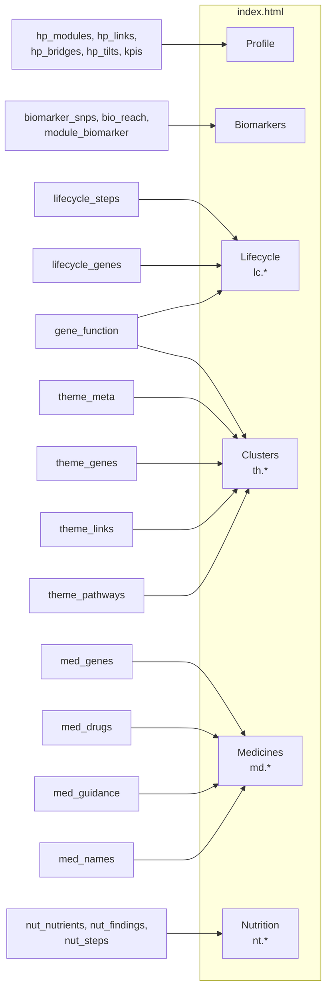
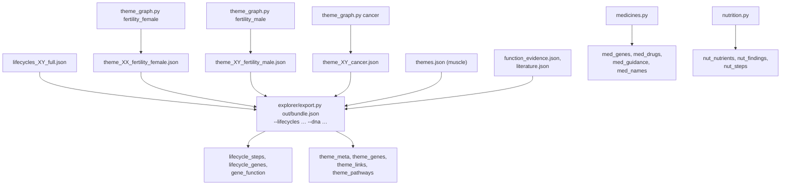
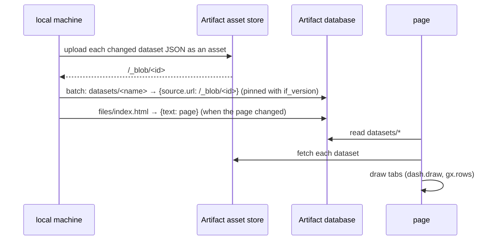
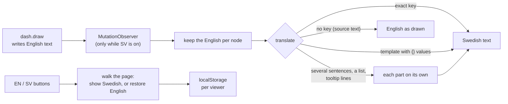

# The Gene Cluster Explorer

A local web page, served on 127.0.0.1 by `python -m cluster_analysis.explorer serve` (it was first a claude.ai artifact,
no longer updated). The page holds no genotypes itself; it reads the datasets next to it.

## Tabs and their datasets



## Producing the datasets



```bash
python -m cluster_analysis.themes.theme_graph fertility_female
python -m cluster_analysis.themes.theme_graph fertility_male
python -m cluster_analysis.themes.theme_graph cancer
python -m cluster_analysis.medicines.medicines
python -m cluster_analysis.nutrition.nutrition
python -m cluster_analysis.library.overlay data/input/MyHeritage_raw_dna_data_XY.csv --dashboard out   # Profile tab datasets
python -m cluster_analysis.explorer.export out/bundle.json \
    --lifecycles data/output/cluster_analysis/lifecycles_XY_full.json      # every profile; the 207-gene walk
```

Gene rows carry the evidence call (`function`: GoF / LoF / normal / altered / unknown) and what it means for the
person (`outcome`: positive / negative / neutral / unclear / typical / unknown; see
[evidence.md](evidence.md#from-the-call-to-positive-or-negative)). The library's old 1–10 ratings are not shown.

Each dataset is a flat list of rows. Nested data (evidence, SNP lists, frequencies) is stored as a JSON string in a
field and parsed by the page.

## Publishing



Only changed datasets need uploading; the others keep their asset. Every write is pinned to the version last read, so
a concurrent change is never overwritten.

## Language (English / Swedish)

The page is drawn in English. A translation layer (`i18n.js`, the page's last script) follows what is drawn and, with
Swedish selected, shows each text in Swedish. The drawing code doesn't change, and English stays the fallback.



Two dictionaries arrive with the page's other data; text drawn before one arrives is translated when it does:

| Dataset | File | Holds |
|---|---|---|
| `i18n_sv` | `explorer/i18n_sv.json` (~830 entries) | The page's own wording, with `{}` templates |
| `i18n_sv_terms` | `explorer/i18n_sv_terms.json` (~1,600) | Source terms: the library's traits, systems and genotype readings, module names, disease and trait names from Open Targets, the GWAS Catalog and ClinVar |

`explorer/i18n_terms.py` lists which source terms the datasets and the library contain and which still lack Swedish.
Long source texts stay English: UniProt and ClinPGx/CPIC texts, Reactome and GO names, paper titles. A dosing
recommendation is safer read in its original wording than in a translation.

Templates are matched by scanning for their fixed parts, not with regular expressions: a regex with several open
values can backtrack for minutes on a long paragraph. Results are remembered per text, so the cost is paid once.

## Page parts

`page.html` is the shell and `th.*`, `lc.*`, `md.*`, `nt.*` and `i18n.js` are the parts; `build.py` assembles them into
`index.html` and the minified copy that is published (`build/publish.json`, checked against the artifact's 256 KiB
document limit). Colours are CSS tokens with light and dark values. `build.py --standalone` writes the same page as a
static site with its own runtime (`runtime/dash.js`) and tokens (`runtime/tokens.css`), so it runs without claude.ai;
see [migration.md](migration.md).
