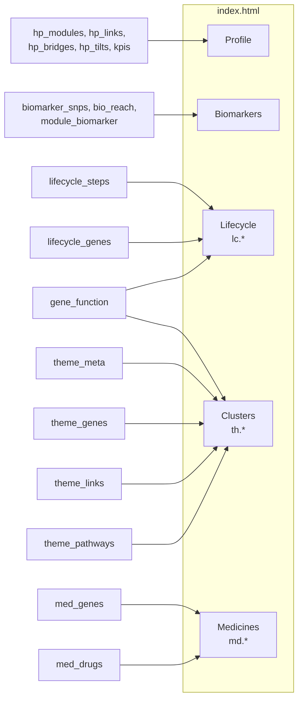
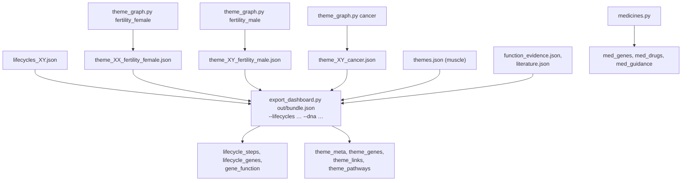
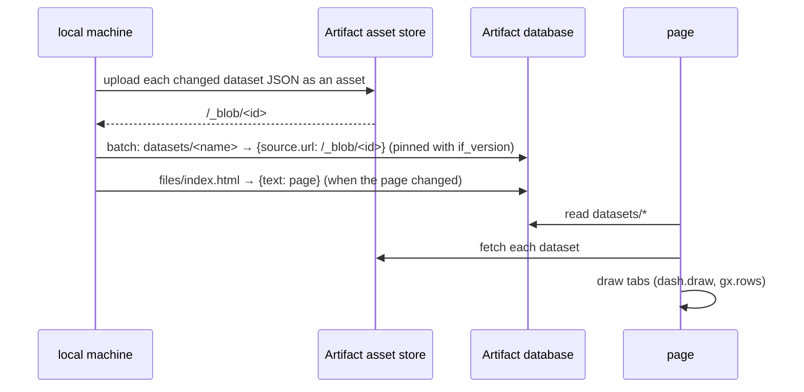

# The Gene Cluster Explorer

A private claude.ai Dashboard artifact: https://claude.ai/artifact/Rsz3RYugnZyvWnixS9168o. The page holds no
genotypes itself; it reads datasets uploaded next to it.

## Tabs and their datasets



## Producing the datasets



```bash
python -m cluster_analysis.theme_graph fertility_female
python -m cluster_analysis.theme_graph fertility_male
python -m cluster_analysis.theme_graph cancer
python -m cluster_analysis.medicines
python -m cluster_analysis.export_dashboard out/bundle.json \
    --lifecycles data/output/cluster_analysis/lifecycles_XY.json --dna data/input/MyHeritage_raw_dna_data_XY.csv
```

Each dataset is a flat list of rows. Nested data (evidence, SNP lists, frequencies) is stored as a JSON string in a
field and parsed by the page.

## Publishing



Only changed datasets need uploading; the others keep their asset. Every write is pinned to the version last read, so
a concurrent change is never overwritten.

## Page parts

`index.html` is the complete page as published. `lc.*`, `th.*` and `md.*` are its parts for editing; after a change,
the same edit goes into `index.html`. Colours are CSS tokens with light and dark values; the page runs on the
Dashboard runtime, so it doesn't open as a plain local file. Local checks use a harness that loads the datasets from
disk and renders with headless Chrome.
