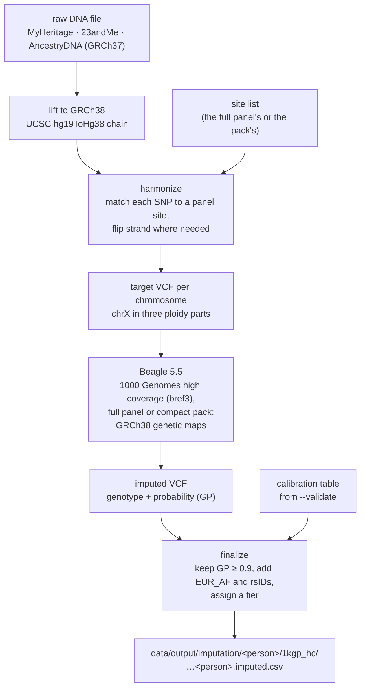
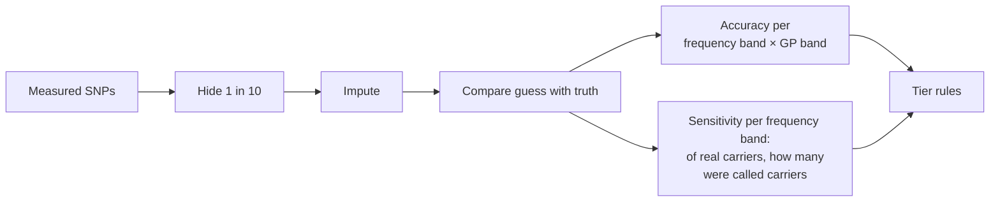
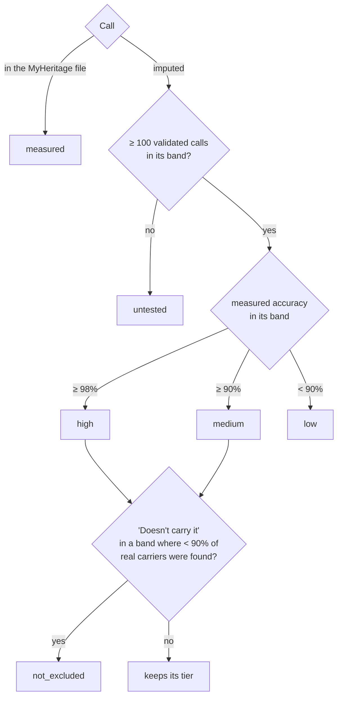
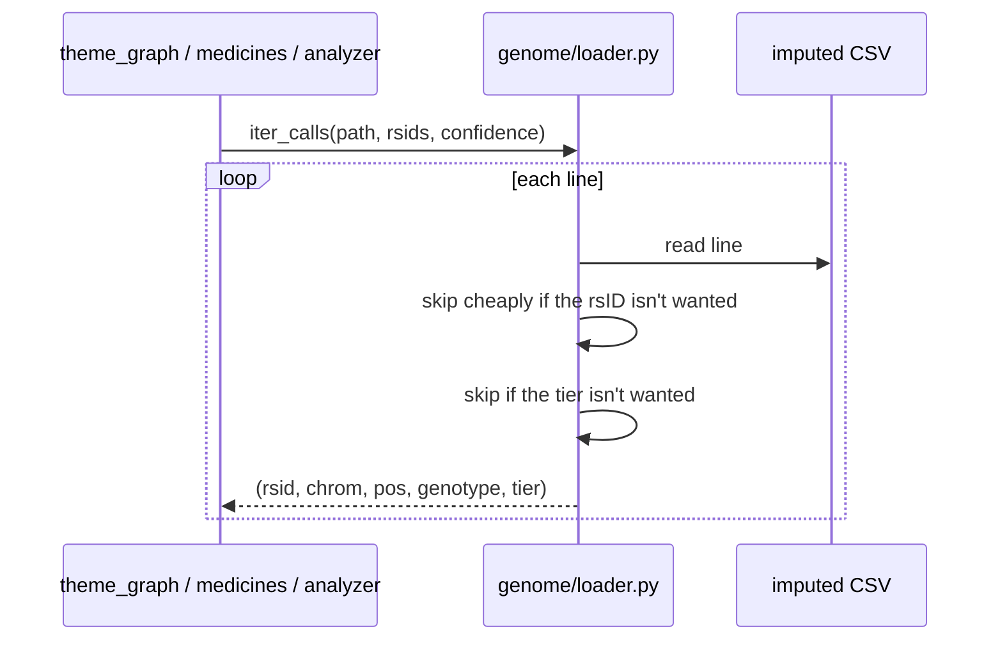

# Imputation and confidence tiers

`genome/impute.py` fills in the positions a consumer DNA test didn't measure, by comparing the person's measured SNPs
with the haplotypes of the people in a 1000 Genomes reference panel (Beagle 5.5, run locally). Each new call gets a
confidence tier, so later steps can decide which calls to trust. Nothing leaves the machine.

In the app, imputation is one stage of adding a person (`cluster_analysis/pipeline.py`: check, register, impute,
analyse, load into the explorer). Where it can't run, the person is added in lite mode (below).

## Input files

`genome/formats.py` reads MyHeritage (CSV), AncestryDNA (the `.txt`, or the `.zip` Ancestry delivers) and 23andMe
files, gzipped or zipped, into one shape: rsid, chromosome, position, genotype. All three are GRCh37; `impute.py`
stops when fewer than 70% of a file's positions are 1000 Genomes sites, which is what a file on another build looks
like (MyHeritage files match 98.7%). `python -m genome.formats FILE` shows what a file holds.

The AncestryDNA reader is tested on synthetic files (`tests/test_formats.py`) and on a MyHeritage file rewritten in
Ancestry's layout: every call reads the same, and chromosome 22 imputes to byte-identical output.

Test files without anyone's private data: `genome/sample_person.py` writes a 1000 Genomes sample's genotypes in any of
the three formats, at the positions of a real chip file or of an Illumina manifest (`--layout`, `--format`). The
manifests in `data/reference/chips/download` come from Illumina's support site: the Global Screening Array (GSA v3,
the base of 23andMe v5) and OmniExpress-24 (close to AncestryDNA v2). Chip names that aren't rsIDs (`1:103380393`) are
kept as they are, as the companies' own files do.

Beagle's output depends on its thread count (`--threads`): the same file on 6 and 8 threads differed in 1.8% of
chromosome 22's calls, mostly uncertain ones. Keep the thread count fixed where results must be reproducible.

## Panels and genome builds

| Panel | Build | People | Calls kept per person | Where |
|---|---|---|---|---|
| `1kgp_hc`: 1000 Genomes high coverage (30×), the default | GRCh38 | 3,202 | ~62 million | 12 GB of bref3 outside the repo (`DNA_PANEL_DIR_1KGP_HC`) |
| `1kgp_hc`, the compact pack (below) | GRCh38 | 3,202 | the 1.98 million positions the app reads | 1.2 GB in `data/reference/imputation/pack`, shipped with the installer |
| `1kg_phase3`: 1000 Genomes phase 3 | GRCh37 | 2,504 | ~28 million | `data/reference/imputation/panel` |

`genome/build.py` (`DNA_BUILD`, default GRCh38) picks the panel and every reference file that must share its
coordinates: ClinVar, Ensembl genes, the site list, the PGS scoring files. Results go to per-build folders
(`data/output/cluster_analysis_GRCh38`, `data/output/explorer_GRCh38`), so `DNA_BUILD=GRCh37` still reproduces the
earlier analysis for comparison.

On GRCh38, MyHeritage's GRCh37 positions are lifted with UCSC's `hg19ToHg38` chain when the file is read (about 270
of 585,000 calls don't map and are dropped). chrX is imputed in three parts (PAR1, the body, PAR2), because men are
diploid in the pseudo-autosomal regions and haploid between them, and Beagle wants one ploidy per sample per file.
The panel names variants `chrom:pos:ref:alt`; rsIDs and frequencies per superpopulation come from its site list,
built by `genome/panel_sites.py` from the panel itself and Ensembl's GRCh38 dbSNP files (98% of SNPs get an rsID).

```bash
sh scripts/fetch_1kgp_hc_panel.sh "D:/DNA-Analyzer-reference/1kGP_high_coverage_GRCh38"   # download, check, convert
python -m genome.panel_sites                                                                # the site list
python -m genome.build fetch                                                                # GRCh38 ClinVar and genes
python -m genome.references status                                                          # is everything there?
```

None of this needs Docker: the site list, the chrX split and the record counts read the panel's VCFs in Python
(`genome/vcf.py`), and are checked against the panel's index counts.

### Reference files

`genome/references.json` lists every reference file: its source and version, how it is made, and what uses it. It
sorts them into tiers:
- `impute`: needed to impute a person.
- `analyse`: needed to analyse the result.
- `built`: made here from the sources (the PGS reference, the imputability map).
- `source`: the raw panel (32 GB) and dbSNP (13 GB), kept so every built file can be rebuilt without downloading.
- `grch37`: the comparison build.

`python -m genome.references status` shows what is present and whether a run can start. `lock` writes checksums to
`data/reference/references.lock.json`. `verify` checks the raw panel against the 1000 Genomes MD5 manifest, and the
rest against the lock file.

Measured the same way (every 10th SNP hidden), both panels are equally accurate on what a chip can test: 98.9% of
confident calls right, 99.5% at high confidence. The high-coverage panel's gain is coverage (2.2× the calls) and the
build the sources use. Its "doesn't carry it" calls for uncommon variants found 89.5% of real carriers in XY (91% on
phase 3), just below the 90% bar, so those calls read `not_excluded`.

### What a chip can see: the imputability map

`genome/imputability.py` measures, site by site, what a chip plus imputation can recover. It holds out 100 European
founders from the panel, masks them to the chip's positions, imputes them with Beagle against the other 3,102 people
and compares each site with their real genotypes. Each site gets a class from its measured r² (or, where the held-out
people carry fewer than 3 copies of the minor allele, from the calibrated r² of its frequency and DR2 band):

| Class | Sites (chr1–22) |
|---|---|
| chip: measured | 559,703 |
| reliable: r² ≥ 0.8 | 11,347,429 |
| uncertain: r² ≥ 0.5 | 2,465,197 |
| not knowable | 56,319,686 |

```bash
python -m genome.imputability run       # per chromosome, about 7 hours in all; per-site tables on D:
python -m genome.imputability summary   # summary.json, genes.json, clinvar_variants.json in data/reference/imputability
```

`genes.json` counts ClinVar's pathogenic and likely pathogenic variants per gene by class, plus those not in the panel
at all (339,655 of 340,908 on chr1–22) and those on chrX (`not_mapped`; chrX isn't mapped yet). The explorer's
Clusters tab shows it per theme and per gene ("What a chip can see"), so a clean result says how much it rules out.

### Imputation without the full panel: the compact pack

The full panel is 12 GB and lives on a developer's machine, so an installed app ships a **compact pack** instead: the
same panel, all 3,202 people, cut to the positions this app needs. `impute.panel()` uses it whenever the full panel's
folder isn't there; it has the same panel name, so outputs land where they always do.

The pack keeps (`scripts/spike/build_pack.py`, recorded in `pack/pack.json`):
- the chip positions of the supported formats: MyHeritage's layout, the GSA (23andMe v5) and OmniExpress (AncestryDNA
  v2) manifests, lifted to GRCh38;
- every position the analysis reads: the rsIDs every analysis step asks for (traced through `genome.loader`), the
  genome-wide polygenic scores, and the ClinVar and GWAS Catalog variants inside the theme genes;
- chrX in the same three ploidy parts as the full panel.

That is 1.98 million biallelic SNVs (3% of the panel's 64 million), 1.2 GB as bref3, about 350 MB in the installer
after compression. In a genome-wide validation (a panel sample left out of the reference and imputed from its chip
positions, `scripts/spike/validate_pack.py`) the pack was as accurate as the full panel at every position the analysis
reads: 99.19% of genotypes exact against 99.20%, r² 0.9875 against 0.9877. Imputing chr1-22 with the pack took about
11 minutes on a 6-thread desktop. How it was measured, and what remains before it ships everywhere:
[production.md](production.md), "Imputation without the 12 GB panel".

```bash
python scripts/spike/build_pack.py targets <analysis-rsids.json> <chip-imputed.csv>   # the positions to keep
python scripts/spike/build_pack.py extract                                             # cut the raw panel per chromosome
python scripts/spike/build_pack.py xsplit && python scripts/spike/build_pack.py sites   # chrX parts, the site list
python scripts/spike/build_pack.py bref3 && python scripts/spike/build_pack.py install  # -> data/reference/imputation/pack
```

### Lite mode: measured calls only

When imputation can't run (no Java, no panel or pack, or the person chooses it), `genome/lite.py` moves the file's
measured calls to GRCh38 with the same chain file and writes them in the imputed file's format, every row `measured`:
`data/output/imputation/<person>/<panel>/…<person>.measured.csv`. `genome.loader.imputed_path` reads it when there is
no imputed file, so the whole analysis runs on the measured calls; an imputation made later takes its place. It takes
under a minute. The price is coverage: in a comparison on one profile, the lab-test scores used 17% of the variants
they use with imputation, and cancer scores 53%.

## Pipeline



```bash
sh scripts/fetch_1kgp_hc_panel.sh "D:/DNA-Analyzer-reference/1kGP_high_coverage_GRCh38"   # the full panel (developers)
python -m genome.impute data/input/<file>.csv                  # impute 1-22 and X, then finalize
python -m genome.impute data/input/<file>.csv --validate 10    # hide every 10th measured SNP and score the guesses
python -m genome.lite data/input/<file>.csv                    # lite mode: measured calls only
```

Output columns: `RSID, CHROMOSOME, POSITION, RESULT, SOURCE, GP, EUR_AF, CONFIDENCE`.

## How the tiers are measured

`--validate` hides every tenth measured SNP (~58k for XY), imputes them and compares each guess with the real call.
Accuracy is counted per **allele-frequency band** (how common the variant is) and per **GP band** (Beagle's own
certainty). With one person, Beagle's DR2 quality score is 0 at homozygous sites, so GP is used instead.



## Tiers



| Tier | Meaning | Used for |
|---|---|---|
| measured | Reported by MyHeritage | Everything |
| high | ≥ 98% correct in validation | Everything, marked "imputed" |
| medium | ≥ 90% correct | Theme findings (GWAS, ClinVar non-pathogenic), not single-SNP conclusions |
| low | < 90% | Counted, not used |
| untested | Fewer than 100 validation calls in its band | Counted, not used |
| not_excluded | "Doesn't carry it" for a rare variant imputation often misses | Shown as "not detected, not excluded" |

`genome/loader.py` applies the policy: `CONFIDENT = ("measured", "high")` is the default for single-SNP conclusions
(library, medicines, pathogenic carrier status). `theme_graph.py` uses `FINDING_TIERS = measured, high, medium` for
findings and `CARRIED_TIERS = measured, high` for pathogenic variants.

## Reading the file



`imputed_path()` swaps a raw file for its imputed version when one exists, so every command takes the raw path and
uses the imputed file automatically (`--measured-only` turns that off). Without one it falls back to the lite file.

A half-written file is never read. `impute.py` writes the CSV under a temporary name (`.partial`) and renames it only
when complete (`publish`), then writes `summary.json` with its totals; `loader.imputation_complete` accepts an imputed
file only when a summary with totals is at least as new as the file. So a run stopped half way (closed app, full disk,
cancelled) leaves no file the analysis could take for a whole one, and Resume carries on from the stage it reached.
