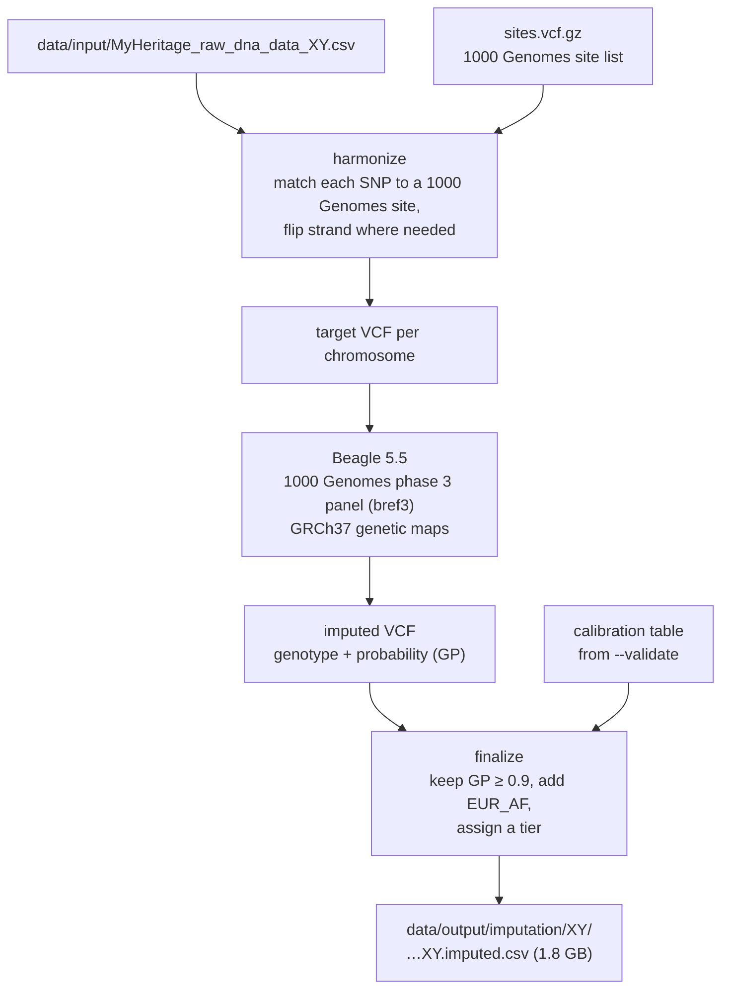
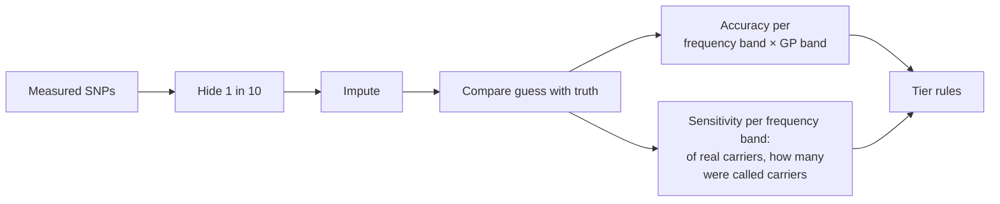
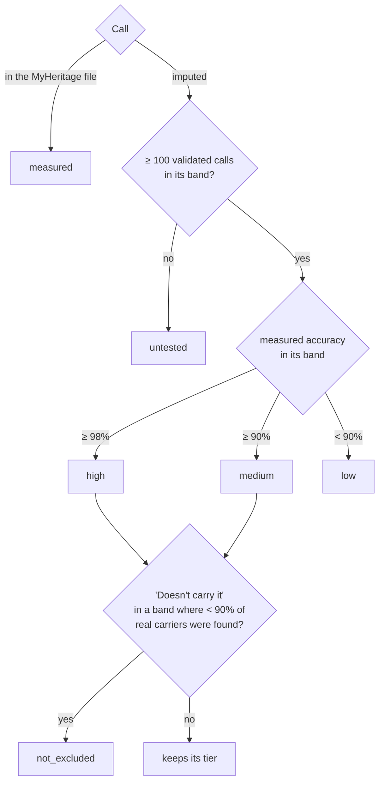
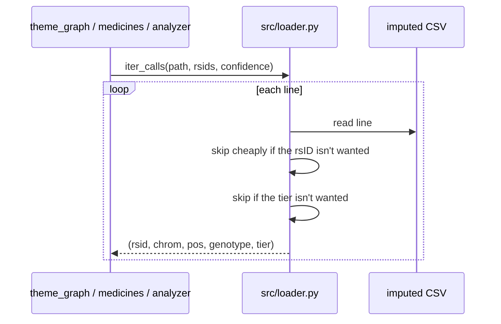

# Imputation and confidence tiers

`src/impute.py` fills in the SNPs MyHeritage didn't report, by comparing the person's measured SNPs with the
haplotypes of the 2,504 people in 1000 Genomes. It takes a file from ~600k SNPs to ~28 million calls. Each new call
gets a confidence tier, so later steps can decide which calls to trust.

## Pipeline



```bash
bash scripts/fetch_imputation_reference.sh                      # Beagle, panels, maps, site list (~5 GB)
python -m src.impute data/input/MyHeritage_raw_dna_data_XY.csv     # impute, then finalize
python -m src.impute data/input/... --validate 10                 # hide every 10th measured SNP and score the guesses
```

Output columns: `RSID, CHROMOSOME, POSITION, RESULT, SOURCE, GP, EUR_AF, CONFIDENCE`.

## How the tiers are measured

`--validate` hides every tenth measured SNP (~58k for XY), imputes them and compares each guess with the real call.
Accuracy is counted per **allele-frequency band** (how common the variant is) and per **GP band** (Beagle's own
certainty). With one person, Beagle's DR2 quality score is 0 at homozygous sites, so GP is used instead.



## Tiers



| Tier | Meaning | Used for |
|---|---|---|
| measured | Reported by MyHeritage | Everything |
| high | ≥ 98% correct in validation | Everything, marked "imputed" |
| medium | ≥ 90% correct | Theme findings (GWAS, ClinVar non-pathogenic), not single-SNP conclusions |
| low | < 90% | Counted, not used |
| untested | Fewer than 100 validation calls in its band | Counted, not used |
| not_excluded | "Doesn't carry it" for a rare variant imputation often misses | Shown as "not detected, not excluded" |

`src/loader.py` applies the policy: `CONFIDENT = ("measured", "high")` is the default for single-SNP conclusions
(library, medicines, pathogenic carrier status). `theme_graph.py` uses `FINDING_TIERS = measured, high, medium` for
findings and `CARRIED_TIERS = measured, high` for pathogenic variants.

## Reading the file



`imputed_path()` swaps a raw file for its imputed version when one exists, so every command takes the raw path and
uses the imputed file automatically (`--measured-only` turns that off).
