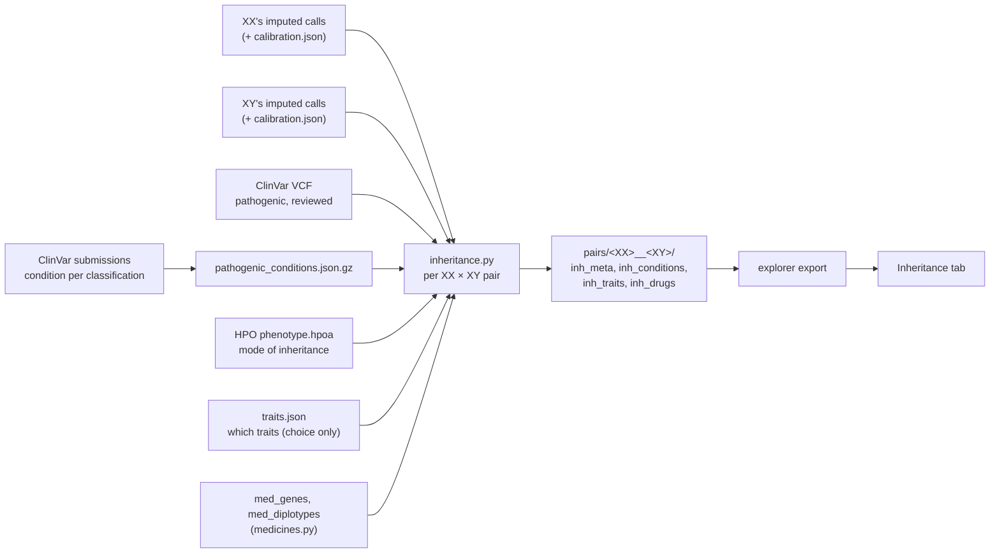

# Inheritance

What a child of an XX and an XY profile could inherit, as odds. Package `cluster_analysis/inheritance/`, tab
Inheritance in the explorer.

At every position each parent passes one of their two copies, each with a chance of one half; a man's single X goes to
every daughter and to no son. For a variant both parents have a call at, the child's genotype odds follow exactly. How far
they hold depends on how far the parents' calls do, and each row states that separately.



## Three parts

| Part | Variants | Mode of inheritance | The child |
|---|---|---|---|
| Conditions | ClinVar pathogenic or likely pathogenic, reviewed (one star up), not conflicting, carried by either parent | HPO, per condition | Affected and carrier shares per mode; on the X per son and daughter |
| Traits | The single-gene traits `traits.json` chooses; the variant allele from their ClinVar record | HPO, where it annotates the trait's OMIM entry; otherwise "not given by a source" | Genotype odds, and the share showing the trait when a mode is known |
| Drug genes | Each parent's two star alleles (Medicines) | None: both alleles count | The four equally likely pairs, typed with CPIC's rules |

- Several variants in one gene are counted together. Each parent passes one of two chromosomes, and two different
  variants in one parent are taken to sit on different chromosomes; a chip can't tell which.
- A ClinVar record lists every condition any submitter named. A condition keeps its mode only when it has at least half
  as many reviewed pathogenic submissions as the variant's most-named condition. C282Y in HFE has 30 for hemochromatosis
  type 1 and one each for Alzheimer disease and the porphyrias, from a single lab's gene-wide list: only hemochromatosis
  type 1 (recessive) counts.
- Modes are not applied to ClinVar's risk-factor or association records: those are susceptibility alleles, and a
  Mendelian mode would turn a small per-copy effect into "affected".
- The drug genes' pair table (`med_diplotypes.json`) is written by `medicines.py` and holds no genotype: the package
  meets Medicines only through files.

## How far a call can be trusted

| A parent's call | Accuracy given |
|---|---|
| Imputed (high or medium) | The share of such calls (frequency band, GP band, carrier or not) that were right in that person's own imputation check (`calibration.json`) |
| Measured, common variant (≥ 1%), or not carrying the variant | Above 99%: chip against sequencing in 49,908 UK Biobank participants (Weedon et al., BMJ 2021, PMID 33589468) |
| Measured, carrying a very rare variant (< 0.001%) | 16% of such chip calls were confirmed by sequencing (same study) |
| Measured, carrying a variant in between | No number: chip calls get less reliable the rarer the variant |
| Imputed low, untested or not excluded | Not used: the child's odds that depend on it are not given |

A row's confidence is the chance both parents' calls are right, the product of the two. When one parent's call can't
be used, the tab gives what still follows, the chance a child gets the other parent's variant copy, and not the odds of
being affected.

## The prediction engine: traits for a child, and for one person

`predict.py` turns the GWAS Catalog into one model per trait (2,494): an anchor study (European, at least 10,000 people,
the most lead variants after keeping the strongest per 500 kb), its effect alleles placed on the forward strand against the
1000 Genomes sites with their European frequency, and EFO's definition (`efo_obo`). The models are person-free and built
once (`gwas_trait_models`).

- **A child** (Inheritance tab): each parent passes the effect allele with chance copies/2, so the child's score has an
  expected value (always between the parents) and a spread from the coin-toss genes (the 8-in-10 and 98-in-100 fields).
  Genes where both parents carry two identical letters are settled; the others are left to chance; each row lists both.
- **One person** (Biomarkers tab): the person's own score on every trait (`profiles/<id>/trait_scores.json`, dataset
  `trait_scores`), with the genes that move them most against the average European.

Results are shown as "Top N%" or "Bottom N%" with the trait's direction (CLAUDE.md). Traits studied in one sex only (the
study's sample description) are left out for the other.

## Running it

```bash
python -m cluster_analysis.inheritance                     # every XX x XY pair of finished profiles
python -m cluster_analysis.inheritance --pair XX_1 XY_1
python -m cluster_analysis.inheritance --person XX_1       # every pair with XX_1 (profiles.py step "inheritance")
python -m cluster_analysis.inheritance.predict build        # the trait models (once)
python -m cluster_analysis.inheritance.predict person XY_1  # one person's place on every trait
```

The pipeline runs it as the last analysis step when a person is added, and deleting a person removes every pair folder
with them in it. The pair folders hold both parents' genotypes, so they stay in `data/output`. Sources:
`hpo_annotations`, `clinvar_submissions` and the built `clinvar_pathogenic_conditions` in `genome/references.json`.

## How much a scale says: GWAS impact and the papers' own figures

Every trait's scale says how much it can say, first thing under "See the genes" (`ihImpact` in `ih.js`, used by the
Biomarkers tab too).

- **GWAS impact** (`inheritance/gwas_impact.py`, `{ref}/inheritance/trait_impact.json`): the share of the differences
  between people that the study's lead variants explain, the same way for all 2,494 trait models. Each lead variant's
  chi-square (from the Catalog's `PVALUE_MLOG`, which doesn't underflow) over the study's sample size estimates the
  variance it explains; the lead variants are one per 500 kb, so the shares add up. Unit-free, unlike the Catalog's
  effect sizes (most only say "unit"). It counts the lead variants only (a full genetic score explains more), leans
  high for a study's strongest hits (winner's curse), and for a case-control study is on that study's observed scale.
  Checked against the papers that report the same thing: BMI 6.3% against 5.4%, waist-hip 2.8% against 3.9%, puberty
  3.4% against 2.7%, menopause 6.9% against 10.1%. Levels (the user's, 2026-11-26): high impact 8% and over, modest 3 to 8%, little under 3%. Over the 2,450 scorable traits the median is 3.34% and the mean 4.16% (quartiles 1.41% and 5.68%, 90th percentile 7.97%); 244 are high, 1,085 modest, 1,121 little. Measurements: median 3.82%, mean 4.62%. Case-control studies: median 0.32%, mean 1.42%, being on each study's observed scale. Studies of 100,000+ people have a lower median (0.56%) than small ones: the large ones are mostly behaviours and diseases, the small ones metabolites and proteins with one strong gene each. `python -m cluster_analysis.inheritance.gwas_impact --stats` prints them; the page shows each trait's rank and the median and mean beside its figure (`window.GX_SOURCES.impact`, put in by `build.py`). Each trait carries it as `impact` (%), and the Biomarkers list can
  sort by it ("Highest impact first").
- **What the study itself reports** (`inheritance/impact.py`, `impact_picks.json`, `{ref}/inheritance/featured_impact.json`):
  for the familiar traits, the sentence of the study's own abstract or open full text that says how much its score
  explains (variance, SNP heritability, AUC or hazard ratio), quoted with a link. The picks file only chooses the
  sentence; a pick counts only when the paper's text holds its quote and its figure. Traits whose paper reports none,
  or whose text isn't open, say so.

## Families

A profile can name its parents (`"parents": ["XX_1", "XY_1"]` in `cluster_analysis/profiles.json`). `inheritance.related`
treats a parent and child, or two profiles sharing a parent, as close family; `pairs()` never makes them a couple,
and the pickers in the Inheritance tab and in Ask leave them out (`ihRelated` in `ih.js`, `pickPair` in `ask.js`).

## Testing the predictions on a real child (`forecast.py`)

1. `python -m cluster_analysis.inheritance.forecast freeze XX_1 XY_1 --sex female`, before the child is added. It
   writes the pair's predictions for a child of that sex, the odds for every variant read in both parents and the
   single-gene traits, drug genes and conditions, into
   `pairs/XX_1__XY_1/forecast-<time>.json`, and the SHA-256 of its content into `pairs/forecasts.json`.
2. Add the child with `"parents"` set, impute it.
3. `python -m cluster_analysis.inheritance.forecast check XX_2`. It refuses a forecast whose content no longer matches
   its seal or that is newer than the child, and reports:
   - **Mendel:** child genotypes no pair of parental copies can give, split into all-measured calls and calls with
     imputation. On measured chip calls this should be near the chip's error rate; much higher means a wrong call
     tier, a strand problem, or a wrong relationship.
   - **Variant odds:** bits of information per variant over Hardy-Weinberg at European frequencies, and the share of
     settled variants (both parents homozygous) that came out as settled.
   - **Traits:** (child's own z minus the predicted z) / the predicted spread. If the model is right this is a
     standard normal: 80% inside the 80% field, 98% inside the 98% one, mean 0, spread 1, overall and by impact level.
     Too many misses: the fields miss variance (imputation errors, unread variants counted as the average); a mean
     off 0: a bias, such as an allele flipped against the strand.
   - **Single-gene traits:** the child's copies and the odds given to that outcome.

## Which scales overlap (`overlap.py`)

Every trait model is scored on the 525 European founders of the 1000 Genomes panel (genotypes read from its raw VCFs
at the 52,100 model positions, into `<panel>/pgs_ref/trait_models/` on D:), and every two scales are correlated: r near
1, they rank people alike; near 0, unrelated; negative, opposite. Counting shared genome regions doesn't work (BMI's
1,048 regions with their neighbours cover half the genome). 1,866 traits have a related scale at |r| >= 0.3; BMI's are
childhood body size, waist, weight, hip and body fat (0.33-0.39). Families at |r| >= 0.6 by single linkage chain
widely (lipids: 249) and need a stricter rule before use.

### What the first check on a real child showed (2026-11-26)

The first sealed forecast was checked against a real daughter of two profiles. Her results stay private; what it
showed about the method:

- The Mendelian parts hold: settled variants came out as settled, impossible genotypes were rare (near chip error
  rates), and the variant odds carry clear information over population frequencies. The embedding placed her among
  the simulated daughters and far from every simulated stranger.
- **Flaw 1, the normal approximation.** A trait driven mostly by one rare variant with a large effect has a lumpy
  distribution, not a bell curve. When neither parent has a call at such a variant and the child carries it (about a
  5% event for a 2.5% variant), the field calls it a 4-standard-deviation miss. Fix: the child's exact distribution
  (the three outcomes of each variant combined), or a flag on traits where one variant carries most of the variance.
- **Flaw 2, slightly wide fields** (a little more than 80% inside the 80% field) with a small shift. One child's coin
  tosses move many related traits together, so thousands of traits are not thousands of independent tests; a
  second child or the public 1000 Genomes trio will tell whether it is real.
- **Flaw 3, the embedding's baseline is too clean.** Simulated siblings carry no call errors, a real child's file
  does, so a real child sits at the far edge of the sibling range. Fix: add the measured call-error rate to the
  simulated siblings.

### The comparison view (`explorer/ic.js`)

`forecast check` keeps every compared trait in its report; `explorer export` turns each child's latest check into the
`inh_checks` dataset (personal, on this computer only). The Inheritance tab then shows a switch, Prediction or
Predicted vs actual (`ih_view=compare`, `ih_child`), which hides one set of cards and shows the other
(`#inheritance[data-view]`). The comparison reuses the tab's own scales (`ihScale`) and marks the child's actual place
on them as a gold ring.

## The X chromosome in the trait models (2026-11-26)

Until 0.1.15 the trait models left out every X variant; the single-gene traits and conditions already handled the X.
Now the GWAS Catalog's X associations are kept, and each variant outside the two pseudo-autosomal regions (which pair
with the Y and are inherited like autosomes; `genome/build.par()`) is marked `x`.

- **Counting a man's X.** One copy, counted as 0 or 2 (full dosage compensation), so his genotype is written as a pair
  ("AA") and scored like a woman's homozygote. This is a common coding of men's X in genome-wide studies, so a study's
  effect sizes fit it; studies that coded men 0 or 1 would be off by a factor for men. `predict.moments` holds it:
  mean 2f for both sexes, variance 2f(1-f) for a woman and 4f(1-f) for a man.
- **Ranked against one's own sex.** Each person's place is against Europeans of their sex on the X (the same as before
  for every trait without X variants); each parent in a pair against their own sex.
- **A child.** A daughter gets one X from each parent: her father's single X passes for certain (0 or 1 copy from
  him), her mother's as a coin toss. A son gets his mother's X only, counted 0 or 2: odds 1-q of none, q of "two".
  `predict.predict(model, xx, xy, child_sex)`; `variant_odds` in `forecast.py` the same.
- **Two rows where it matters.** A trait with X variants gets a prediction for a daughter and one for a son
  (`child_sex` XX / XY); a trait without gets one row (`child_sex` any), since on the autosomes a son and a daughter
  inherit alike. The Inheritance tab reads the rows for the child's sex switch; Ask reads a daughter's.

Not yet: sex-specific effect sizes where the Catalog has studies of each sex, the Y and the mitochondria in trait
models, and parent-of-origin (imprinted) effects.
