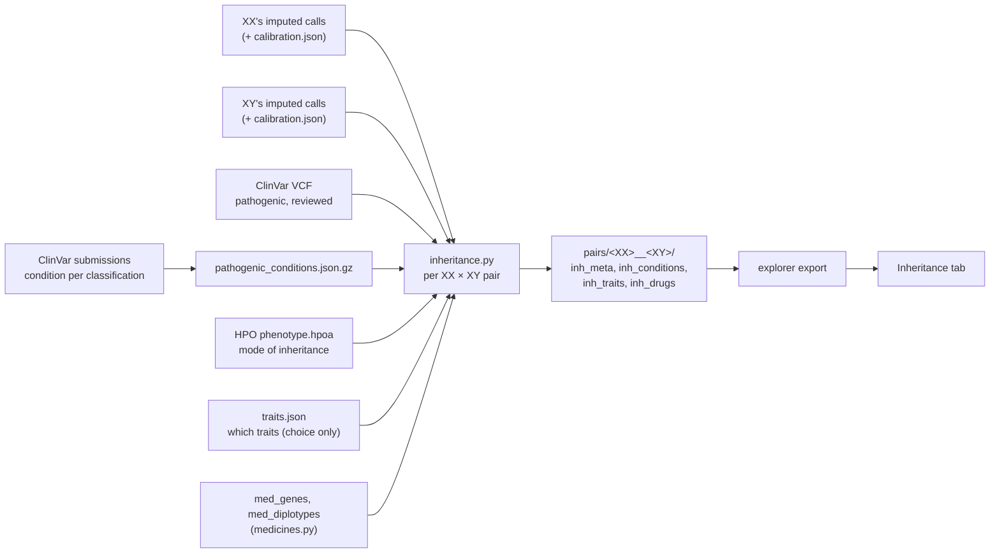

# Inheritance

What a child of an XX and an XY profile could inherit, as odds. Package `cluster_analysis/inheritance/`, tab
Inheritance in the explorer.

At every position each parent passes one of their two copies, each with a chance of one half; a man's single X goes to
every daughter and to no son. For a variant both parents have a call at, the child's genotype odds follow exactly. How far
they hold depends on how far the parents' calls do, and each row states that separately.



## Three parts

| Part | Variants | Mode of inheritance | The child |
|---|---|---|---|
| Conditions | ClinVar pathogenic or likely pathogenic, reviewed (one star up), not conflicting, carried by either parent | HPO, per condition | Affected and carrier shares per mode; on the X per son and daughter |
| Traits | The single-gene traits `traits.json` chooses; the variant allele from their ClinVar record | HPO, where it annotates the trait's OMIM entry; otherwise "not given by a source" | Genotype odds, and the share showing the trait when a mode is known |
| Drug genes | Each parent's two star alleles (Medicines) | None: both alleles count | The four equally likely pairs, typed with CPIC's rules |

- Several variants in one gene are counted together. Each parent passes one of two chromosomes, and two different
  variants in one parent are taken to sit on different chromosomes; a chip can't tell which.
- A ClinVar record lists every condition any submitter named. A condition keeps its mode only when it has at least half
  as many reviewed pathogenic submissions as the variant's most-named condition. C282Y in HFE has 30 for hemochromatosis
  type 1 and one each for Alzheimer disease and the porphyrias, from a single lab's gene-wide list: only hemochromatosis
  type 1 (recessive) counts.
- Modes are not applied to ClinVar's risk-factor or association records: those are susceptibility alleles, and a
  Mendelian mode would turn a small per-copy effect into "affected".
- The drug genes' pair table (`med_diplotypes.json`) is written by `medicines.py` and holds no genotype: the package
  meets Medicines only through files.

## How far a call can be trusted

| A parent's call | Accuracy given |
|---|---|
| Imputed (high or medium) | The share of such calls (frequency band, GP band, carrier or not) that were right in that person's own imputation check (`calibration.json`) |
| Measured, common variant (≥ 1%), or not carrying the variant | Above 99%: chip against sequencing in 49,908 UK Biobank participants (Weedon et al., BMJ 2021, PMID 33589468) |
| Measured, carrying a very rare variant (< 0.001%) | 16% of such chip calls were confirmed by sequencing (same study) |
| Measured, carrying a variant in between | No number: chip calls get less reliable the rarer the variant |
| Imputed low, untested or not excluded | Not used: the child's odds that depend on it are not given |

A row's confidence is the chance both parents' calls are right, the product of the two. When one parent's call can't
be used, the tab gives what still follows, the chance a child gets the other parent's variant copy, and not the odds of
being affected.

## The prediction engine: traits for a child, and for one person

`predict.py` turns the GWAS Catalog into one model per trait (2,494): an anchor study (European, at least 10,000 people,
the most lead variants after keeping the strongest per 500 kb), its effect alleles placed on the forward strand against the
1000 Genomes sites with their European frequency, and EFO's definition (`efo_obo`). The models are person-free and built
once (`gwas_trait_models`).

- **A child** (Inheritance tab): each parent passes the effect allele with chance copies/2, so the child's score has an
  expected value (always between the parents) and a spread from the coin-toss genes (the 8-in-10 and 98-in-100 fields).
  Genes where both parents carry two identical letters are settled; the others are left to chance; each row lists both.
- **One person** (Biomarkers tab): the person's own score on every trait (`profiles/<id>/trait_scores.json`, dataset
  `trait_scores`), with the genes that move them most against the average European.

Results are shown as "Top N%" or "Bottom N%" with the trait's direction (CLAUDE.md). Traits studied in one sex only (the
study's sample description) are left out for the other.

## Running it

```bash
python -m cluster_analysis.inheritance                     # every XX x XY pair of finished profiles
python -m cluster_analysis.inheritance --pair XX_1 XY_1
python -m cluster_analysis.inheritance --person XX_1       # every pair with XX_1 (profiles.py step "inheritance")
python -m cluster_analysis.inheritance.predict build        # the trait models (once)
python -m cluster_analysis.inheritance.predict person XY_1  # one person's place on every trait
```

The pipeline runs it as the last analysis step when a person is added, and deleting a person removes every pair folder
with them in it. The pair folders hold both parents' genotypes, so they stay in `data/output`. Sources:
`hpo_annotations`, `clinvar_submissions` and the built `clinvar_pathogenic_conditions` in `genome/references.json`.
