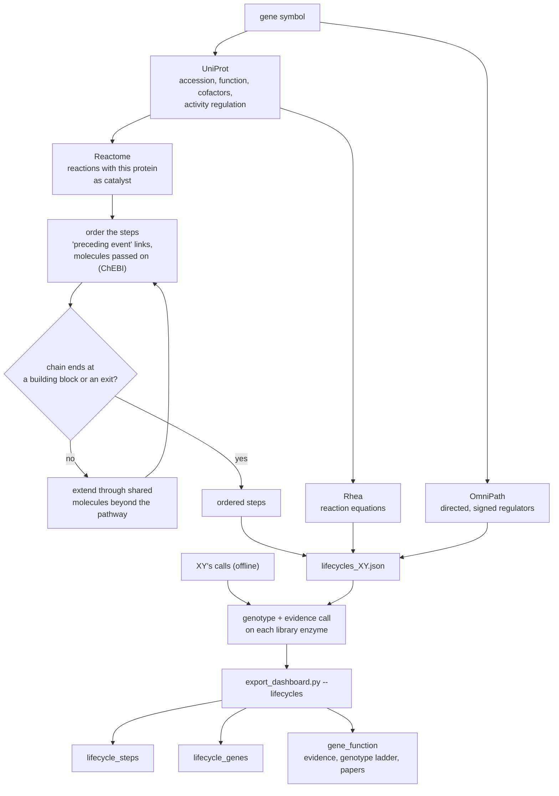
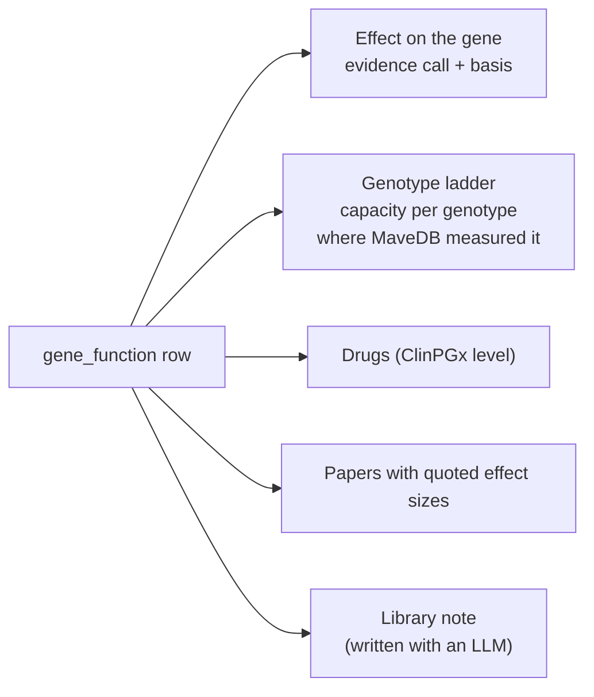

# Gene lifecycles

The Lifecycle tab follows one gene's product through the body: where its building block comes from, the reactions
before and after the gene's own step, the cofactors it needs, who regulates it, and where the product ends up
(excreted, made inert, burned for energy or recycled). The person's genotype is shown on every library enzyme.

## Building a lifecycle



```bash
python -m cluster_analysis.lifecycle MTHFR ALDH2 --dna data/input/MyHeritage_raw_dna_data_XY.csv --out data/output/cluster_analysis/lifecycles_XY.json
python -m cluster_analysis.gene_trace ALDH2 --dna data/input/MyHeritage_raw_dna_data_XY.csv     # upstream / downstream trace of one gene
```

## The gene panel



Hub molecules that sit in hundreds of reactions (water, ATP, NAD) are treated as currency and don't link steps;
otherwise every lifecycle would connect to every other.
