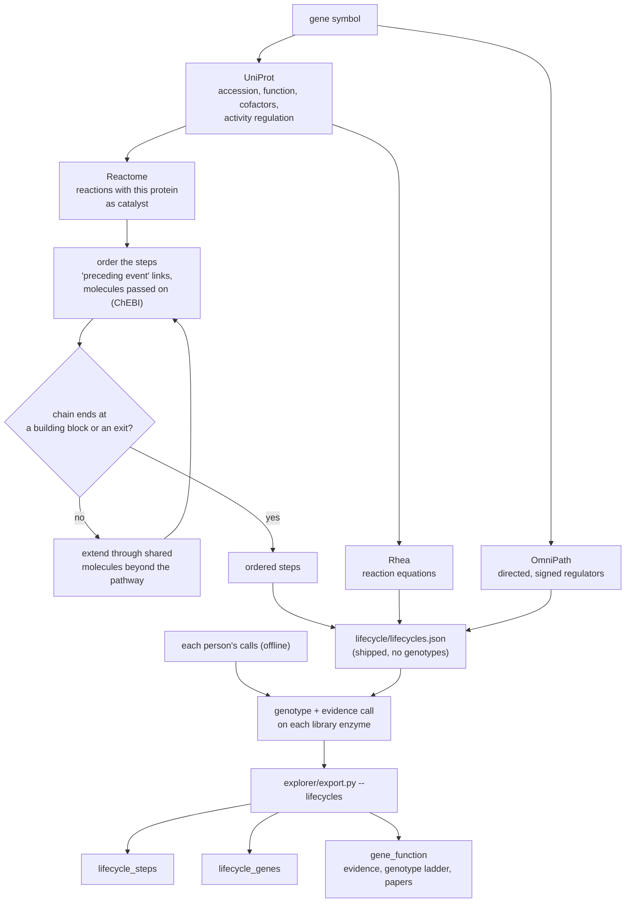
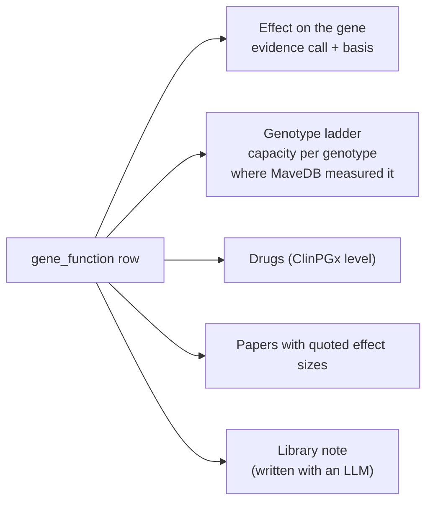

# Gene pathways

The Gene pathway tab follows one gene's product through the body: where its building block comes from, the reactions
before and after the gene's own step, the cofactors it needs, who regulates it, and where the product ends up
(excreted, made inert, burned for energy or recycled). The person's genotype is shown on every library enzyme.

The code keeps its older name: the `cluster_analysis/lifecycle` package, the `lifecycle_*` datasets and the tab id
`lifecycle` all belong to this tab. Only the name users see changed ("Gene lifecycle" became "Gene pathway" on 2026-11-16).

## Building a pathway



The published set covers every library gene that has Reactome reactions (207 genes, ~500 pathway roles). Use the
first word of each library `gene` field as the symbol: the rest is an alias in brackets ("AOC1 (DAO)"), and an
alias on its own can name a different protein (DAO is D-amino acid oxidase). TNF is listed as "TNF-alpha" and needs
its official symbol. Reactome returns 503s under load; rerun the failed genes and merge.

The file is built without a DNA file and committed, so every install has the Gene pathway tab and the introduction's
alcohol-chain example (ADH1B, ALDH2): `explorer/export.py --lifecycles` puts each person's own calls on it.
`tests/test_lifecycles.py` checks it holds no genotype. (Until 2026-11-23 it was built with XY's DNA and lived only
in data/output, so fresh installs had neither.)

```bash
GENES=$(python -c "import json; print(' '.join(sorted({v['gene'].split()[0] for v in json.load(open('cluster_analysis/library/snp_traits.json', encoding='utf-8')).values()})))")
python -m cluster_analysis.lifecycle.lifecycle $GENES TNF --out cluster_analysis/lifecycle/lifecycles.json   # no --dna: the file ships
python -m cluster_analysis.lifecycle.gene_trace ALDH2 --dna data/input/MyHeritage_raw_dna_data_XY.csv     # upstream / downstream trace of one gene
```

## The gene panel



Hub molecules that sit in hundreds of reactions (water, ATP, NAD) are treated as currency and don't link steps;
otherwise every lifecycle would connect to every other.
