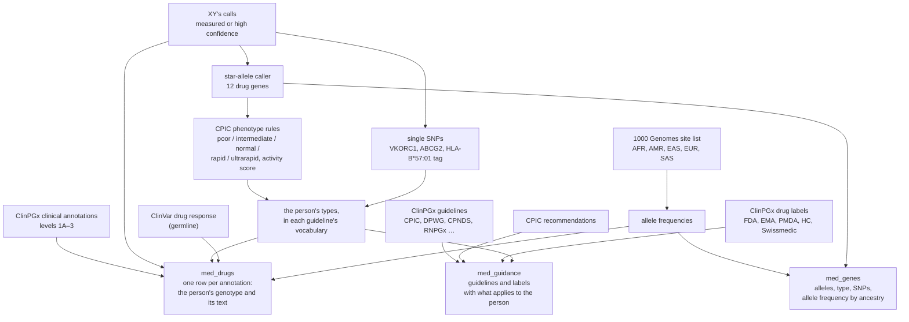
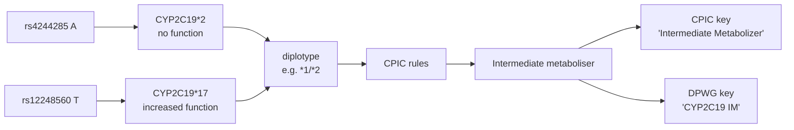
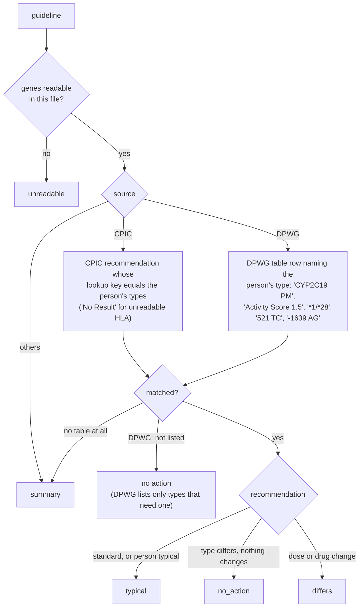

# Medicines

`medicines.py` answers how the person's genome bears on drug response. All of it runs offline on bulk files from
ClinPGx (formerly PharmGKB), CPIC, ClinVar and 1000 Genomes.

```bash
bash scripts/fetch_pgx_reference.sh          # ClinPGx annotations, guidelines, labels; CPIC recommendations
python -m cluster_analysis.medicines         # XY, imputed file when there is one
```

## Overview



## From SNPs to a metaboliser type



Activity-score genes (CYP2C9, CYP2D6, DPYD) carry a score too ("1.5"), which CPIC and DPWG use instead of a word.
Limits of SNP data: CYP2D6 deletions and duplications can't be seen (the call assumes two copies), HLA types other
than *57:01 need HLA typing, and rare DPYD variants beyond the four CPIC tests aren't read.

## Matching a guideline to the person



Drug labels are matched by gene only: a label is `differs` when it names a gene where the person isn't typical.
Tumour-testing labels and "no clinical PGx" labels are left out.

## Typical, and across ancestries

"Typical" for a single SNP is two copies of the allele most Europeans carry, matching XY's ancestry. Each drug gene and
each single-SNP row also carries the allele's frequency in all five 1000 Genomes ancestries (African, American, East
Asian, European, South Asian), because several pharmacogenetic variants are far more common outside Europe
(CYP2C19*2 and *3 in East Asia, NUDT15 in East Asia and Latin America, CYP2D6*17 in Africa).

## Datasets

| Dataset | One row per | Shown in the tab |
|---|---|---|
| `med_genes` | drug gene | Yes |
| `med_drugs` | ClinPGx annotation or ClinVar drug-response record | ClinPGx rows yes; ClinVar rows not yet |
| `med_guidance` | guideline or drug label | Not yet |

The ancestry frequencies (`ancestry`, `freq`) and `med_guidance` are produced by `medicines.py` but the Medicines tab
doesn't display them yet.
