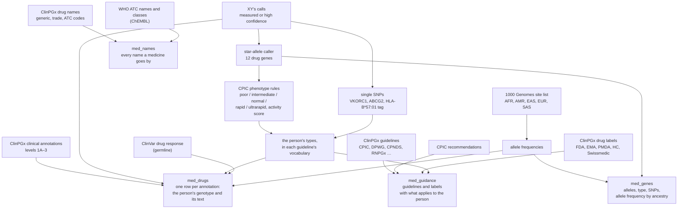
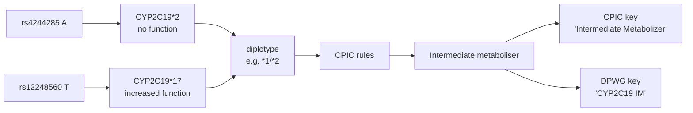
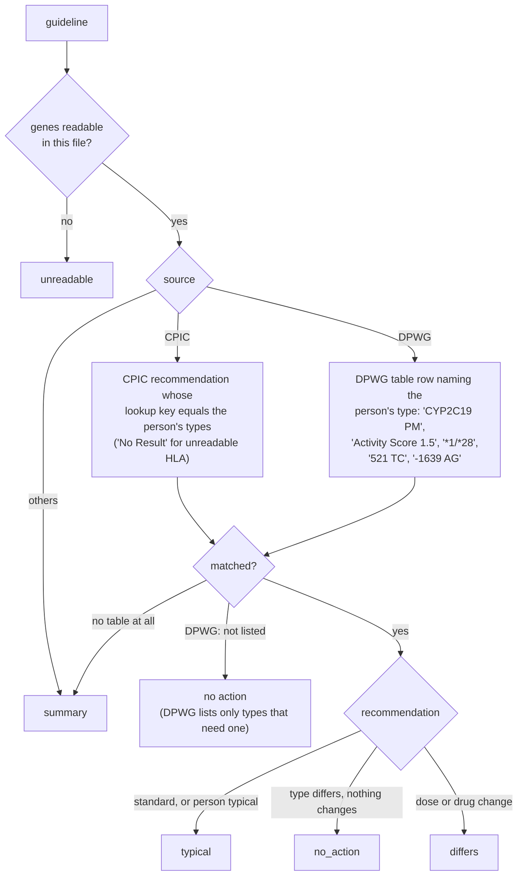

# Medicines

`medicines.py` answers how the person's genome bears on drug response. All of it runs offline on bulk files from
ClinPGx (formerly PharmGKB), CPIC, ClinVar and 1000 Genomes.

```bash
bash scripts/fetch_pgx_reference.sh          # ClinPGx annotations, guidelines, labels, drug names; CPIC recommendations; WHO ATC names
python -m cluster_analysis.medicines.medicines         # XY, imputed file when there is one
```

## Overview



## Finding a medicine

ClinPGx files medicines under their US generic names (acetaminophen, rifampin, albuterol). `med_names` holds every
other name per medicine, so the Medicines tab finds it by any of them:

| Search | Finds | From |
|---|---|---|
| paracetamol, rifampicin, salbutamol | acetaminophen, rifampin, albuterol | WHO ATC name (the international name used in Europe) |
| Alvedon, Panadol, Tylenol | acetaminophen | ClinPGx trade names |
| N02BE01, N02BE | acetaminophen | ATC code |
| analgesics, beta blocking agents | every medicine in that ATC group | ATC class names |

An annotation naming several medicines ("acetaminophen; aspirin; diclofenac") is listed under each of them.

## Reading a finding

Each single-SNP finding in `med_drugs` carries, besides ClinPGx's text for the person's genotype:

| Field | Example (rs10929303, acetaminophen) | Shown as |
|---|---|---|
| `genotype` | CT | the person's result, highlighted (amber when it differs from the typical genotype) |
| `variant_allele`, `copies` | T, 1 | "one copy of T, the less common allele (23% of alleles in Europeans)" |
| `effect` | decreased risk of liver failure due to unintentional acetaminophen overdose | the effect line under the result |
| `others` | CC: increased risk …; TT: decreased risk … | what the other genotypes would mean |

`effect` is the phrase after "may have / require / experience …" in ClinPGx's text; the full text stays one click
away. The medicines a study names are tags on the finding, each a search away. The search box suggests medicines,
international names, drug classes and brands as you type.

## Dose and study size

- **Dose line** (guidance cards): `dose_line()` reads the dose a CPIC or DPWG recommendation states for the person's
  type: "Adjusted dose: decreased dose of 400 mg/day", "Standard dose: 75 mg/day", "Standard dose", or "Use an
  alternative medicine first". Adjusted or standard follows the guideline's status for the person, not the wording.
  About a quarter of CPIC's recommendations state a number; the rest say standard dosing, an alternative, or titration.
- **Study line** (findings): the studies behind each ClinPGx annotation (`clinpgx_variant_annotations.zip`, linked
  through `clinical_ann_evidence.tsv`): how many, n (people or samples, each study's largest analysis), the smallest
  p-value, and the odds, hazard or risk ratio with its 95% CI where reported (about half of findings).
- Not shown: the dose used in each trial. Only about 12% of findings have a study that states one (9% at grade C),
  usually in passing, so it can't put the weaker findings into dose terms.

## Evidence grades

Nothing is filtered out by evidence: every finding is shown with a grade, the strongest first.

| Grade | ClinPGx annotation | ClinVar | Guideline / drug label |
|---|---|---|---|
| **A+** | level 1A | | every dosing guideline (CPIC, DPWG …); label "testing required" |
| **A** | level 1B | reviewed by an expert panel | label "testing recommended" or "actionable" |
| **B** | level 2A, 2B | | label "informative" |
| **C** | level 3 (one study, or studies that disagree) | other submissions | |

A medicine's status (typical / differs) comes from its strongest evidence; when only weaker findings differ, the card
says so beside it ("Weaker evidence (C) differs"). Each medicine shows its dosing guidance first (the recommendation for
the person's type), then every finding with the person's genotype.

## From SNPs to a metaboliser type



Activity-score genes (CYP2C9, CYP2D6, DPYD) carry a score too ("1.5"), which CPIC and DPWG use instead of a word.
Limits of SNP data: CYP2D6 deletions and duplications can't be seen (the call assumes two copies), HLA types other
than *57:01 need HLA typing, and rare DPYD variants beyond the four CPIC tests aren't read.

## Matching a guideline to the person



Drug labels are matched by gene only: a label is `differs` when it names a gene where the person isn't typical.
Tumour-testing labels and "no clinical PGx" labels are left out.

## Typical, and across ancestries

"Typical" for a single SNP is two copies of the allele most Europeans carry, matching XY's ancestry. Each drug gene and
each single-SNP row also carries the allele's frequency in all five 1000 Genomes ancestries (African, American, East
Asian, European, South Asian), because several pharmacogenetic variants are far more common outside Europe
(CYP2C19*2 and *3 in East Asia, NUDT15 in East Asia and Latin America, CYP2D6*17 in Africa).

## Datasets

| Dataset | One row per | Shown in the tab |
|---|---|---|
| `med_genes` | drug gene | Yes |
| `med_drugs` | ClinPGx annotation or ClinVar drug-response record | ClinPGx rows yes; ClinVar rows not yet |
| `med_guidance` | guideline or drug label | Not yet |

The ancestry frequencies (`ancestry`, `freq`) and `med_guidance` are produced by `medicines.py` but the Medicines tab
doesn't display them yet.
