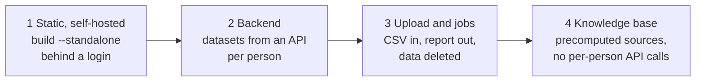

# Moving off claude.ai

The Gene Cluster Explorer is published as a claude.ai Dashboard artifact. That has served development well: a private
link to share, no server to run. It doesn't fit a service that receives other people's DNA files. This page lists what
is tied to claude.ai, what is already independent of it, and the steps to a self-hosted service.

## What is tied to claude.ai today

| Piece | On claude.ai | Self-hosted |
|---|---|---|
| Runtime the page draws with | `dash.draw`, `dash.data`, `dash.calc`, `dash.params`, `dash.setParams`, `dash.setLink`, `dash.colors` | `explorer/runtime/dash.js` (done) |
| Design tokens (`--color-*`, `--cds-*`, `--font-*`) | Provided by the runtime | `explorer/runtime/tokens.css` (done) |
| Script scope | Each `<script>` in its own scope | The standalone build wraps each script the same way (done) |
| Page size | One database document, 256 KiB: the published copy is minified | No limit |
| Datasets | Uploaded as assets, pointed to by `datasets/<name>` documents | Static files now (`data/<name>.json`), an API later |
| Publishing | Claude's Artifact and ArtifactData tools only | Any deploy |
| Who can see it | Whoever the artifact is shared with | Our own accounts and access rules |
| Failure log | `data/users/<id>/runs` in the artifact database | Our own logging |
| Where the data lives | Anthropic's servers, including two people's genotypes | Our own EU hosting |

The page itself is plain DOM code plus d3. Nothing in the tabs calls claude.ai directly, only `window.dash`, which is
why the standalone runtime is small.

## What is done

- **One build.** `explorer/build.py` assembles `page.html` and the parts into `index.html` and the minified publish
  copy. Before, parts were pasted into `index.html` by hand, and one had already drifted (`th.css` was missing a rule).
- **The standalone runtime.** `build.py --standalone DATASET_DIR OUT_DIR` writes the page as a static site:
  `runtime.js`, `tokens.css`, `index.html` and `data/*.json`. Serve it with `python -m http.server`.
- **Checked against the artifact.** The same 137 states (every theme, facet, organ and picked gene; 25 lifecycles;
  medicines; biomarkers; profile) rendered on both runtimes with headless Chrome: no errors on either, and every text
  the standalone page draws is one the artifact draws too. English and Swedish.
- **A configurable data source.** The runtime reads `data/<id>.json` next to the page, or the URL a server gives it
  with `window.DASH_DATA_URL = (id) => ...`. A backend can serve the datasets without the page changing.

## The steps from here

1. **Static, self-hosted.** The standalone build on an EU host behind a login, for in-house use. Possible now. Swap
   claude.ai for it once it runs; the artifact can stay as a demo with synthetic profiles.
2. **Backend.** A small Python service (the pipeline is Python) serves each person's datasets:
   `GET /api/people/{id}/datasets/{name}`. The page reads them through `DASH_DATA_URL`. Dataset names and their row
   fields (see [explorer.md](explorer.md)) become the API's contract, so the tabs don't change.
3. **Upload and jobs.** A professional uploads a customer's CSV with the consent record. A job runs QC (format,
   genome build, sex check), imputation and the analysis, writes the report, and deletes the DNA file and every
   intermediate. The pipeline steps exist (`profiles.py run`, `explorer/export.py`); they need a job runner, storage
   and the deletion step.
4. **Knowledge base.** The sources are fetched per gene and variant, not per person: GWAS Catalog, ClinVar, ClinPGx,
   Reactome, GTEx, UniProt, Ensembl VEP, PGS Catalog, and frequencies, linkage and imputability from the 1000 Genomes
   panel. Built once, versioned by release date, refreshed monthly. A person's analysis is then a lookup: minutes
   instead of hours, nothing about the person leaves our servers, and each report names the data release it used.

Running alongside: the old library (`cluster_analysis/library/snp_traits.json`) and its reader (`cluster_analysis/library/`) still feed parts of the Clusters themes (the
library calls beside the API-built ones). Those are replaced with the API-built equivalents before the service launches.

## Open decisions

| Decision | Options | Note |
|---|---|---|
| Hosting | An EU provider (Hetzner, Scaleway, OVH, an EU region of a larger cloud) | Genetic data stays in the EEA |
| Login | Accounts for professionals; customers never log in | Each professional sees only their own customers |
| Frontend | Keep the page as is, or port tab by tab to a framework later | Not needed for steps 1–3: the page works unchanged |
| Imputation | Run per upload (needs the panel and CPU), or measured variants only | See [imputation.md](imputation.md) |
