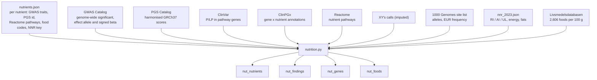

# Nutrition

`nutrition.py` answers what the person's genes say about the nutrients they need, and which foods supply them. Every
number comes from an official source or a public database; nothing is written by an LLM.

```bash
bash scripts/fetch_nutrition_reference.sh    # NNR 2023 (Livsmedelsverket), the food database, PGS Catalog scores
python -m cluster_analysis.nutrition         # XY, imputed file when there is one; men 25–50, PAL 1.6 by default
python -m cluster_analysis.nutrition --sex women --age "25–50 år" --activity medium --dna data/input/X.csv
```

`python cluster_analysis/nutrition.py` (an editor's Run button) works too: run as a file, the script puts the repo root
on `sys.path` itself. Relative paths (`data/...`) assume the repo root as the working directory.

## Overview



## The genetic level

Each nutrient has one or more blood markers (25-hydroxyvitamin D; ferritin, serum iron and transferrin saturation;
folate and homocysteine ...). For each marker a score:

- **A PGS Catalog score** where one fits (vitamin D: PGS019960, 62 genome-wide significant SNPs, n = 443,734; omega-3
  and DHA: PGS012571 / PGS012569, pruned, n = 136,016).
- **Otherwise one GWAS Catalog study's lead variants**: the European study (else the largest) with the most
  genome-wide significant variants carrying a signed beta, at least 10,000 participants, clumped to one variant per
  500 kb. One study, so the weights share a scale.

Alleles are placed on the forward strand against the 1000 Genomes site list. Palindromic SNPs (A/T, C/G) from the GWAS
Catalog are kept only when the study's allele frequency settles the strand. The person's score is compared with
Europeans from the variants' European frequencies: mean = Σ 2pw, variance = Σ 2p(1−p)w². The variants are pruned or
one per locus, so they are treated as independent. A variant not read (or read at low confidence) counts at the
population mean, and the page shows how many were read. The percentile is the share of Europeans with a lower score.
The 8 variants that move the person furthest from the mean are listed with their shift in score standard deviations.

A marker's `higher` says which way is good: `better` (vitamins), `worse` (homocysteine) or `neutral` (ferritin,
magnesium, where both ends matter). The page reads percentile ≤ 20 or ≥ 80 as low or high, and names the unfavourable
side.

## Reading a result

Take a Vitamin C card that reads `Higher than 7% of Europeans` with the driver `SLC23A1 1×C ▼2.48`.

- **The percentile is a position, not a size.** It places the person's score among Europeans' scores. Genetic
  scores are bunched (each variant moves a level a little), so the 7th percentile can mean a modest blood
  difference. The size in blood terms is Σ β(copies − 2p) over the study's variants, in the study's units (mostly
  standard deviations of the blood level). A low percentile often comes to a few tenths of an SD: a real tilt,
  smaller than what diet does.
- **A driver item is `gene copies×allele ▲/▼shift`.** The allele is the study's effect allele and the count is the
  person's copies of it; the arrow says which way that moves the person, in the score's standard deviations.
  `SLC23A1 1×C ▼2.48`: C raises vitamin C and almost everyone has two; one copy means the other is the rare T
  (V264M, a less active transporter), which pulls the score down. `TCN2 0×C ▼0.18`: a raising allele the person
  doesn't carry. Green is the
  favourable direction, orange the unfavourable one, uncoloured where neither is (ferritin).
- **Some genes move the test more than the body.** TCN1 makes haptocorrin, which carries most serum B12 but not the
  form cells take up (transcobalamin, TCN2). A TCN1 variant lowers total serum B12 partly by carrying less of it, so
  the B12 card's test is holotranscobalamin and methylmalonic acid, not total B12 alone.
- **A score from another ancestry** (B12 and folate: Jacobs 2024, South Asian) uses that study's effect sizes with
  European frequencies. The European findings in the list show whether the direction holds; a strong European locus
  the study lacks (FUT2 for B12) shows there and not in the score.

## Evidence grades

| Grade | Source |
|---|---|
| A+ | ClinVar pathogenic or likely pathogenic, expert panel or practice guideline (3–4 stars) |
| A | ClinVar with criteria from several submitters (2 stars); or a GWAS variant genome-wide significant for the nutrient's markers in 2+ publications, all in the same direction |
| B | ClinVar, one submitter's criteria; or a GWAS variant from one publication |
| C | ClinPGx gene x nutrient annotations (level 3: single studies) |

## Intake and foods

`nnr_2023.json` is parsed from Livsmedelsverket's summary of NNR 2023 (revised June 2025, September 2025 errata
applied). The parser checks every adult cell, strips the footnote markers the PDF prints against a value ("3306" is
330 µg and footnote 6), and checks each quoted note is in the PDF. It holds RI (tables 7, 9), AI (8, 10), UL (16),
reference energy (table 1) and the fat recommendations as a share of energy. The omega-3 target in grams is 1 E% at
the person's reference energy (37 kJ/g). Two upper limits don't cover food: magnesium's (supplements and additives)
and folate's (synthetic folic acid).

Foods are Livsmedelsverket's, ranked per 100 g with the share of the target. Mixed dishes, sweets, spices, baking
ingredients, coffee and tea powders and supplements are left out, and one food per first word of the name is kept.
A food whose 100 g exceeds a food-relevant upper limit is flagged (liver for vitamin A, oysters for zinc).

## Outputs

All in `data/output/cluster_analysis/`, personal except `nut_foods`:

| Dataset | Rows |
|---|---|
| `nut_nutrients` | per nutrient: `target` (JSON), `markers` (JSON: score, percentile, source, top variants), `test`, counts, `sex`, `age` |
| `nut_findings` | per finding: `kind` (GWAS, ClinVar, ClinPGx), `grade`, gene, rsid, genotype, effect allele, copies, direction, p, publications |
| `nut_genes` | per Reactome pathway gene: findings in it, best grade |
| `nut_foods` | per nutrient and food: amount per 100 g, share of target, kcal, over the upper limit |

## Limits

- No zinc, copper, iodine or calcium score: the GWAS Catalog has no usable blood-level studies for them (serum
  calcium is hormonally held). Vitamin E, B6, selenium and carotenoids have studies, but none with 10,000 people.
- B12 and folate scores use the largest study with signed betas, which is South Asian (Jacobs 2024); the page shows
  the sample in the source line's tooltip.
- The food database has no choline or vitamin K values.
- Foods are ranked per 100 g, not per portion: the database has no portion sizes.
- The age group and activity level are arguments, not read from the DNA; the default is men 25–50, PAL 1.6.
- A finding outside nutrition can surface through a marker: Factor V Leiden (F5 rs6025) is a ferritin variant in
  Bell 2021, so a carrier sees it among the ferritin drivers.
