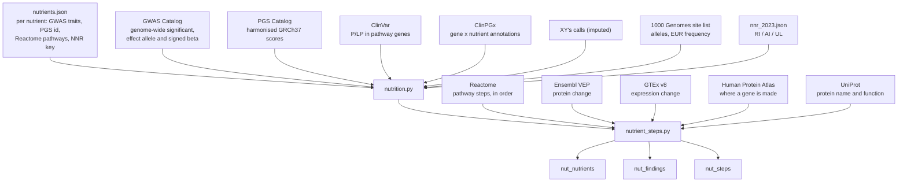

# Nutrition

`nutrition.py` shows where a person's genes act on how the body takes up, carries and converts each nutrient: which
step of the conversion a variant sits on, and how it changes that step. It is not a diet planner: the intake target is
one line of context. Every number comes from an official source or a public database; nothing is written by an LLM.

```bash
bash scripts/fetch_nutrition_reference.sh    # NNR 2023 (Livsmedelsverket) and the PGS Catalog scores, once
python -m cluster_analysis.nutrition         # XY, imputed file when there is one; men 25–50 by default
python -m cluster_analysis.nutrition --sex women --age "25–50 år" --dna data/input/X.csv
```

`python cluster_analysis/nutrition.py` (an editor's Run button) works too: run as a file, the script puts the repo root
on `sys.path` itself. Relative paths (`data/...`) assume the repo root as the working directory. The first run fetches
Reactome steps and summaries, Ensembl VEP, GTEx, the Human Protein Atlas and UniProt (about 15 minutes); they are cached for later runs.

## Overview



## The conversion steps

Each nutrient maps to one or more Reactome pathways (`nutrients.json`), listed in the order the nutrient travels. B12,
for example, has three: *Uptake of dietary cobalamins into enterocytes*, *Transport of RCbl within the body* and
*Cobalamin (Cbl) metabolism*. `nutrient_steps.py` turns each pathway into ordered steps:

- **Order**: Reactome lists a pathway's reactions without an order. A step is placed after the steps it follows: by
  Reactome's "preceding event" links, or because an earlier step hands it a molecule (`lifecycle.links_between`).
  Ties keep Reactome's order; a cycle is broken at the earliest-listed step.
- **Per step**: its name, where in the cell it happens (Reactome compartments: extracellular region, lysosomal lumen,
  mitochondrial matrix ...), whether it moves the molecule across a membrane (transport), and the proteins that do it.
- **Where in the body**: the Human Protein Atlas's RNA tissue specificity per gene (TCN1: salivary gland; GC and MMUT:
  liver; CYP27B1: kidney), or "made in most tissues".

## Pinning a variant to a step

Every finding (GWAS lead variants, the variants that drive a score, ClinVar, ClinPGx) gets a mechanism:

| Mechanism | Rule | Source |
|---|---|---|
| `protein` | The variant lies in a step gene and changes its amino acids (missense, stop, frameshift, splice site). The change is named from the canonical transcript (`V264M`, Val264Met), with the person's copies of the changed allele. | Ensembl VEP |
| `expression` | The variant changes how much of a step gene is made, in any tissue, and lies within 1 Mb of it. The most significant effect is shown, turned to the finding's allele (GTEx reports the alternative allele). | GTEx v8 eQTL |
| `in_gene` | In a step gene, but no protein change or expression effect is known. | Ensembl VEP |
| `outside` | None of the above: the variant moves the level from outside the conversion steps (lipid transport, blood group genes such as FUT2, or a gene not yet known). | |

## The mechanism in writing

The page writes the mechanism out rather than drawing the steps. Every sentence of it is curated source text, not
generated:

- **How it is taken up and converted**: Reactome's summary of each of the nutrient's pathways, in order, with the
  number of steps found. A nutrient without Reactome steps (magnesium, calcium, iodine) has no such section.
- **Where the person's variants act**, one account per gene a variant is pinned to (genes with a variant against the
  person first):
  - *The step*: its place in the pathway ("1 of 7, Uptake of dietary cobalamins into enterocytes"), its name and
    Reactome's summary of that reaction.
  - *The protein*: the gene's protein (UniProt, reviewed human entry), where the Protein Atlas finds it made, and the
    first sentences of UniProt's function text.
  - *The variant(s)*: what each changes (protein or expression), which way it moves the level and for the person,
    how common the genotype is, grade and source.

Citations, evidence codes and PubMed references are stripped from the source text (`nutrient_steps._clean`).

A variant is pinned to the first step whose genes include its gene. The page lists it under that step, and the
summary at the top names each step holding a variant that works against the person.

**Which way it moves the level for the person**: for a GWAS or score variant, d = (copies − 2p) × (+1 if the allele
raises the level, −1 if it lowers it), against the European average 2p. d ≥ 0.5 is "raises", d ≤ −0.5 "lowers",
otherwise "the usual copies". With the marker's `higher` (`better`, `worse`, `neutral`) this decides whether the
variant works against the person (orange) or for them (green).

**How common the genotype is**: each GWAS or score variant shows how many Europeans share the person's genotype,
from the allele's European frequency p (Hardy-Weinberg: p², 2p(1−p) or (1−p)²). Common is 25% or more, fairly common
5–25%, uncommon 1–5%, rare below 1% (then given as "about 1 in N").

**Steps found**: a nutrient's tile and card show how many Reactome steps were found. A nutrient without any (magnesium,
calcium, iodine) shows its blood level and its variants only, under "Variants found".

GRCh37's annotation and GTEx v8 still use some old gene symbols (MUT for MMUT, GIF for CBLIF); `OLD_NAME` in
`nutrient_steps.py` bridges them.

## The net effect on the blood level

Each nutrient has one or more blood markers (25-hydroxyvitamin D; ferritin, serum iron and transferrin saturation;
folate and homocysteine ...), shown as one summary line each. For each marker a score:

- **A PGS Catalog score** where one fits (vitamin D: PGS019960, 62 genome-wide significant SNPs, n = 443,734; omega-3
  and DHA: PGS012571 / PGS012569, pruned, n = 136,016).
- **Otherwise one GWAS Catalog study's lead variants**: the European study (else the largest) with the most
  genome-wide significant variants carrying a signed beta, at least 10,000 participants, clumped to one variant per
  500 kb. One study, so the weights share a scale.

Alleles are placed on the forward strand against the 1000 Genomes site list. Palindromic SNPs (A/T, C/G) from the GWAS
Catalog are kept only when the study's allele frequency settles the strand. The person's score is compared with
Europeans from the variants' European frequencies: mean = Σ 2pw, variance = Σ 2p(1−p)w². The variants are pruned or
one per locus, so they are treated as independent. A variant not read (or read at low confidence) counts at the
population mean. The percentile is the share of Europeans with a lower score. The page puts it in words, as a band
and the end of the range it falls in: very low (≤ 5), low (≤ 20), below average (< 40), average (40–60), above
average (< 80), high (< 95), very high; "Low · in the lowest 7% of Europeans", "Average · near the middle". The 8 variants that move the person
furthest from the mean are added to the findings (kind `Score`) when the GWAS lead list lacks them, so they too are
pinned to steps (the rare FADS2 variants behind the omega-3 score).

## Reading a result

- **The step is the answer; the percentile is the sum.** "SLC23A1 V264M on step 2, sodium-driven uptake of ascorbate"
  says where vitamin C narrows. The percentile adds every variant up into one position among Europeans.
- **The percentile is a position, not a size.** Genetic scores are bunched (each variant moves a level a little), so a
  low percentile can mean a modest blood difference: Σ β(copies − 2p) in the study's units, mostly standard
  deviations of the blood level, often a few tenths of an SD.
- **Some genes move the test more than the body.** TCN1 makes haptocorrin, which carries most serum B12 but not the
  form cells take up (transcobalamin, TCN2). A TCN1 variant lowers total serum B12 partly by carrying less of it, so
  the B12 test line names holotranscobalamin and methylmalonic acid, not total B12 alone.
- **An expression effect is measured in GTEx's tissues**, not necessarily where the step runs (an eQTL found in
  testis for a liver enzyme). The tissue is shown with the effect.
- **A score from another ancestry** (B12 and folate: Jacobs 2024, South Asian) uses that study's effect sizes with
  European frequencies. The European findings show whether the direction holds; a strong European locus the study
  lacks (FUT2 for B12) shows among the findings and not in the score.

## Evidence grades

| Grade | Source |
|---|---|
| A+ | ClinVar pathogenic or likely pathogenic, expert panel or practice guideline (3–4 stars) |
| A | ClinVar with criteria from several submitters (2 stars); or a GWAS variant genome-wide significant for the nutrient's markers in 2+ publications, all in the same direction |
| B | ClinVar, one submitter's criteria; a GWAS variant from one publication; or a variant that drives a published score |
| C | ClinPGx gene x nutrient annotations (level 3: single studies) |

## Intake target

One line of context per nutrient. `nnr_2023.json` is parsed from Livsmedelsverket's summary of NNR 2023 (revised June
2025, September 2025 errata applied). The parser checks every adult cell, strips the footnote markers the PDF prints
against a value ("3306" is 330 µg and footnote 6), and checks each quoted note is in the PDF. It holds RI (tables 7,
9), AI (8, 10), UL (16), reference energy (table 1) and the fat recommendations as a share of energy (the omega-3
target is 1 E% at the reference energy, 37 kJ/g).

## Outputs

All in `data/output/cluster_analysis/`, personal except `nut_steps`:

| Dataset | Rows |
|---|---|
| `nut_nutrients` | per nutrient: `target` (JSON), `markers` (JSON: score, percentile, source, top variants), `pathways` (JSON: Reactome id, name, summary), `proteins` (JSON per pinned gene: UniProt protein name and function), `test`, counts, `sex`, `age` |
| `nut_findings` | per finding: `kind` (GWAS, Score, ClinVar, ClinPGx), `grade`, gene, rsid, genotype, effect allele, copies, direction, `xy` (raises / lowers / typical / carried), `shift`, `mechanism`, `step_gene`, `detail` (JSON: protein change or expression effect), `consequence` |
| `nut_steps` | per step: nutrient, pathway, order, Reactome id and name, where in the cell, transport, genes, inputs and outputs, `tissues` (JSON per gene), `summary` (Reactome's text) |

## Limits

- Reactome has few or no steps for magnesium, calcium, iodine and vitamin E, and no score exists for zinc, iodine
  or calcium: those cards show little.
- Steps cover what Reactome curates. Some genes that set a level act outside them (FUT2 for B12, lipid genes for
  omega-3); they are listed as "outside the conversion steps", not forced onto a step.
- An intergenic GWAS variant is pinned only through an expression effect on a step gene; without one it stays
  outside, even when the nearest gene is a step gene.
- B12 and folate scores use the largest study with signed betas, which is South Asian (Jacobs 2024).
- The age group is an argument, not read from the DNA; the default is men 25–50.
- A finding outside nutrition can surface through a marker: Factor V Leiden (F5 rs6025) is a ferritin variant in
  Bell 2021, so a carrier sees it among the ferritin findings.
