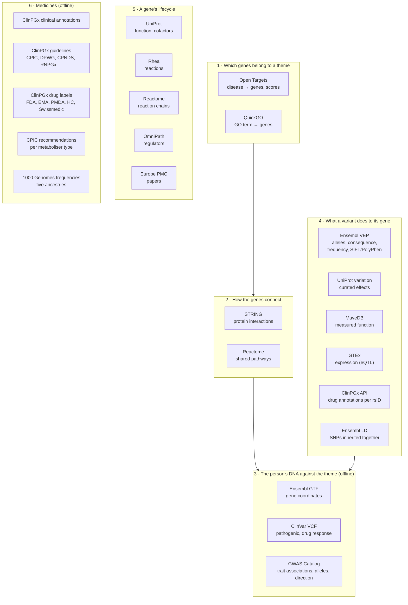
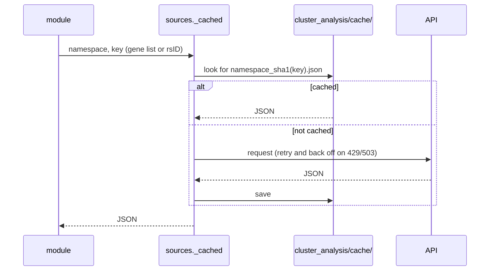

# Sources

Every external source the cluster analysis uses, what it contributes and how it is reached. APIs receive only public
identifiers; bulk files are downloaded once to `data/reference/` (gitignored) and read offline.

## By layer

## Table

| Source | Access | Gives us | Used by |
|---|---|---|---|
| Open Targets | GraphQL API | Genes associated with a disease, with overall and genetic scores | `theme_graph.py` |
| QuickGO | REST API | Genes with experimental or curated GO annotations to a mechanism | `theme_graph.py` |
| STRING | REST API | Protein–protein interactions (confidence ≥ 0.4), enrichment | `theme_graph.py`, `themes.py`, `build_modules.py` |
| Reactome | REST API + `Ensembl2Reactome.txt` | Pathways, ordered reactions, inputs and outputs | `theme_graph.py`, `lifecycle.py`, `gene_trace.py` |
| MyGene.info | REST API | Gene summaries, GO and Reactome per gene | `themes.py`, `sources.py` |
| Ensembl GTF (GRCh37) | Bulk file | Gene start and end, to place SNPs in genes | `theme_graph.py` |
| ClinVar (GRCh37) | Bulk VCF | Pathogenic variants, risk factors, drug response | `theme_graph.py`, `medicines.py` |
| GWAS Catalog | Bulk zip (+ REST API per rsID) | Genome-wide significant associations, effect allele, OR/beta and direction | `theme_graph.py`, `library_audit.py`, `biomarkers.py` |
| Ensembl VEP | REST API | Forward-strand alleles, consequence per allele, European frequency, SIFT/PolyPhen | `sources.py`, `function_evidence.py` |
| Ensembl LD | REST API | Partner SNPs (r² ≥ 0.6, Europeans) so a GWAS lead SNP can support a library SNP | `library_audit.py` |
| UniProt | REST API + `humsavar.txt` | Curated variant effects, protein function, cofactors | `function_evidence.py`, `gene_trace.py` |
| MaveDB | REST API | Deep mutational scan scores per protein change | `function_evidence.py` |
| GTEx v8 | REST API | eQTLs: which allele raises or lowers expression, per tissue | `function_evidence.py` |
| Rhea | REST API | Chemical reactions of an enzyme | `gene_trace.py` |
| OmniPath | REST API | Directed, signed regulators of a gene | `gene_trace.py`, `lifecycle.py` |
| Europe PMC | REST API | Papers naming a SNP, quoted effect sizes | `literature.py` |
| ClinPGx (PharmGKB) | Bulk zips + REST API | Clinical annotations, guideline annotations, drug labels | `medicines.py`, `function_evidence.py` |
| CPIC | REST API, saved as JSON | Recommendation per metaboliser type or activity score | `medicines.py` |
| 1000 Genomes | Bulk panel + site list | Imputation; allele frequencies in five ancestries | `src/impute.py`, `medicines.py` |

Downloads: `scripts/fetch_imputation_reference.sh` (imputation) and `scripts/fetch_pgx_reference.sh` (medicines).

## Caching and politeness

STRING and ClinPGx ask for at most one or two requests per second; the clients sleep between calls.
