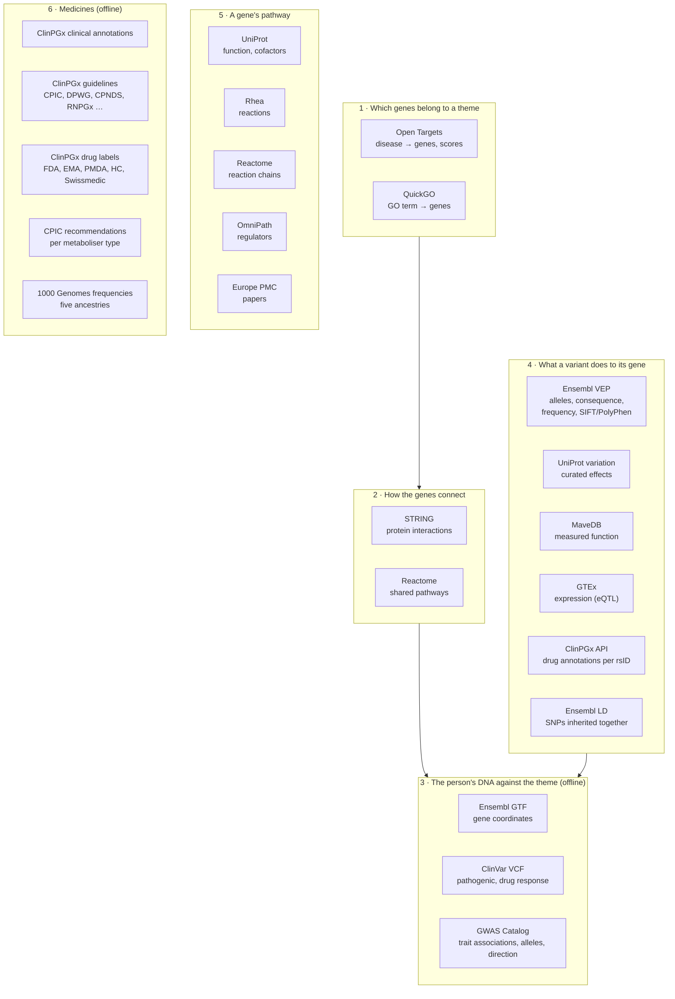
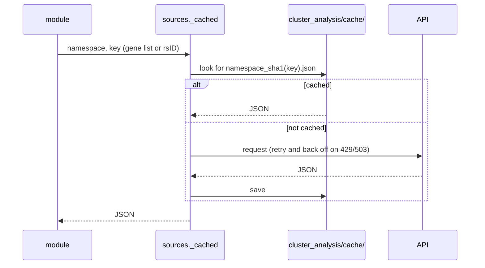

# Sources

Every external source the cluster analysis uses, what it contributes and how it is reached. APIs receive only public
identifiers; bulk files are downloaded once to `data/reference/` (gitignored) and read offline.

## By layer

## Table

The 25 research databases. The list is kept in `cluster_analysis/explorer/sources.json`, which the
explorer's Sources tab and the introduction's count are built from; `tests/test_sources_catalog.py` checks that this table,
that file and `genome/references.json` agree. Bulk files are on GRCh38.

| Source | Run by | Access | Gives us | Tabs | Bulk files (`references.json`) |
|---|---|---|---|---|---|
| [1000 Genomes Project](https://www.internationalgenome.org/) | International Genome Sample Resource (EMBL-EBI) | bulk | Full genomes of 3,202 people from 26 populations: the reference panel imputation reads the missing positions from, and allele frequencies per ancestry. | Home, Clusters, Medicines, Nutrition, Biomarkers | `panel_raw`, `panel_bref3`, `panel_sites`, `panel_populations` |
| [ClinVar](https://www.ncbi.nlm.nih.gov/clinvar/) | NCBI, US National Library of Medicine | bulk | Variants submitted by clinical laboratories with their significance: disease-causing, risk factor or drug response, with a review status in stars. | Clusters, Medicines, Nutrition, Biomarkers | `clinvar_grch38` |
| [GWAS Catalog](https://www.ebi.ac.uk/gwas/) | EMBL-EBI and NHGRI | bulk + API | Genome-wide association studies: which variants are linked to a trait or a lab value, the allele that raises or lowers it, and how strongly. | Clusters, Nutrition, Biomarkers, Profile | `gwas_catalog` |
| [PGS Catalog](https://www.pgscatalog.org/) | EMBL-EBI and the University of Cambridge | bulk | Published polygenic scores: the weights that add up many variants into one genetic score for a blood level or a trait. | Nutrition, Biomarkers, Clusters | `nutrition_pgs`, `pgs_scoring_genomewide` |
| [ClinPGx (PharmGKB)](https://www.clinpgx.org/) | Stanford University | bulk + API | How genes change the response to medicines: clinical annotations per variant, dosing guidelines (CPIC, DPWG and others) and drug labels (FDA, EMA, Health Canada, Swissmedic and others). | Medicines | `clinpgx` |
| [CPIC](https://cpicpgx.org/) | Clinical Pharmacogenetics Implementation Consortium | API, saved | Peer-reviewed dosing recommendations per metaboliser type, and the rules that turn star alleles into a type. | Medicines | `cpic_recommendations` |
| [ChEMBL](https://www.ebi.ac.uk/chembl/) | EMBL-EBI | bulk | The WHO ATC classification of medicines, so a medicine can be found by its class or code. | Medicines | `chembl_atc` |
| [Ensembl](https://www.ensembl.org/) | EMBL-EBI | bulk + API | The genome itself: where each gene lies (GTF), each variant's identity and position (dbSNP), what a variant does to its gene (VEP) and which variants are inherited together (LD). | Clusters, Nutrition, Biomarkers, Gene pathway | `gtf_grch38`, `dbsnp_ensembl` |
| [UniProt](https://www.uniprot.org/) | UniProt Consortium (EMBL-EBI, SIB, PIR) | bulk + API | Proteins: their function and cofactors, and curated effects of protein changes found in people. | Clusters, Nutrition, Gene pathway | `uniprot_humsavar` |
| [MaveDB](https://www.mavedb.org/) | Brotman Baty Institute and partners | API | Laboratory measurements of how each possible protein change affects the protein's function (deep mutational scans). | Clusters | – |
| [GTEx](https://gtexportal.org/) | Genotype-Tissue Expression project (NIH) | bulk + API | How much each gene is made in 54 tissues, and which variants make it more or less active (eQTLs). | Clusters, Nutrition, Biomarkers | `gtex_median_tpm` |
| [Human Protein Atlas](https://www.proteinatlas.org/) | KTH, Uppsala University and SciLifeLab | API | Where in the body each gene is mostly made, tissue by tissue. | Nutrition, Biomarkers | – |
| [Open Targets Platform](https://platform.opentargets.org/) | EMBL-EBI, Wellcome Sanger Institute and partners | API | Which genes are linked to a disease, scored by genetic, clinical and literature evidence. | Clusters | – |
| [Gene Ontology (QuickGO)](https://www.ebi.ac.uk/QuickGO/) | Gene Ontology Consortium, served by EMBL-EBI | API | Which genes take part in a biological process (DNA repair, sperm production …), from experiments and curation. | Clusters | – |
| [STRING](https://string-db.org/) | STRING Consortium (SIB, EMBL, CPR, KU) | API | Which proteins work together, with a confidence score. | Clusters, Profile | – |
| [Reactome](https://reactome.org/) | OICR, EMBL-EBI, NYU and OHSU | bulk + API | Pathways and their reactions step by step: how a nutrient is taken up, carried and converted, and what each step needs. | Clusters, Nutrition, Biomarkers, Gene pathway | `reactome_genes` |
| [Rhea](https://www.rhea-db.org/) | SIB Swiss Institute of Bioinformatics | API | The chemical reactions enzymes carry out. | Gene pathway | – |
| [OmniPath](https://omnipathdb.org/) | Saez-Rodriguez group, Heidelberg University | API | Which genes switch a gene on or off. | Gene pathway | – |
| [MyGene.info](https://mygene.info/) | Su and Wu labs, Scripps Research | API | Gene names, summaries and identifiers, gathered from the main gene databases. | Profile | – |
| [Europe PMC](https://europepmc.org/) | EMBL-EBI | API | Research papers that name a variant, for the literature behind a finding. | Clusters, Gene pathway | – |
| [Nordic Nutrition Recommendations 2023](https://www.livsmedelsverket.se/) | Nordic Council of Ministers, published by Livsmedelsverket | bulk | Recommended intakes and upper limits per nutrient, by sex and age. | Nutrition | `nnr_2023` |
| [IARC Monographs](https://monographs.iarc.who.int/) | International Agency for Research on Cancer (WHO) | API, saved | Which agents cause which cancers in humans, classified by the strength of the evidence. | Home, Clusters | – |
| [European Code Against Cancer](https://cancer-code-europe.iarc.who.int/) | International Agency for Research on Cancer (WHO) and the European Commission | API, saved | Fourteen recommendations for the public on how to lower the risk of cancer (5th edition), in every EU language. | Home | – |
| [MedGen](https://www.ncbi.nlm.nih.gov/medgen/) | NCBI, US National Library of Medicine | API | Definitions of medical conditions, gathered from OMIM, GeneReviews and other curated sources. | Home | – |
| [PubChem](https://pubchem.ncbi.nlm.nih.gov/) | NCBI, US National Library of Medicine | API | Chemistry of each substance: properties, metabolism and toxicology, from curated sources such as HSDB. | Home | – |

IARC Monographs and the European Code Against Cancer are read by `cluster_analysis/themes/cancer_prevention.py` into
`themes/cancer_prevention.json` (in git), which the introduction shows.

Tools, not databases:

| Tool | What it does | Files |
|---|---|---|
| Beagle 5.5 | The imputation program. | `beagle`, `bref3_jar` |
| Genetic maps (GRCh38) | Where DNA is usually cut and recombined between generations, which imputation needs. | `genetic_map_grch38` |
| UCSC liftOver | Moves positions from the older genome build (GRCh37) that some DNA files use to the current one (GRCh38). | `liftover_chain` |

Downloads: `scripts/fetch_imputation_reference.sh` (imputation) and `scripts/fetch_pgx_reference.sh` (medicines).
Every bulk file, with its URL, version and how it is made, is listed in `genome/references.json`. Check them with
`python -m genome.references status`.

## Caching and politeness

STRING and ClinPGx ask for at most one or two requests per second; the clients sleep between calls.
