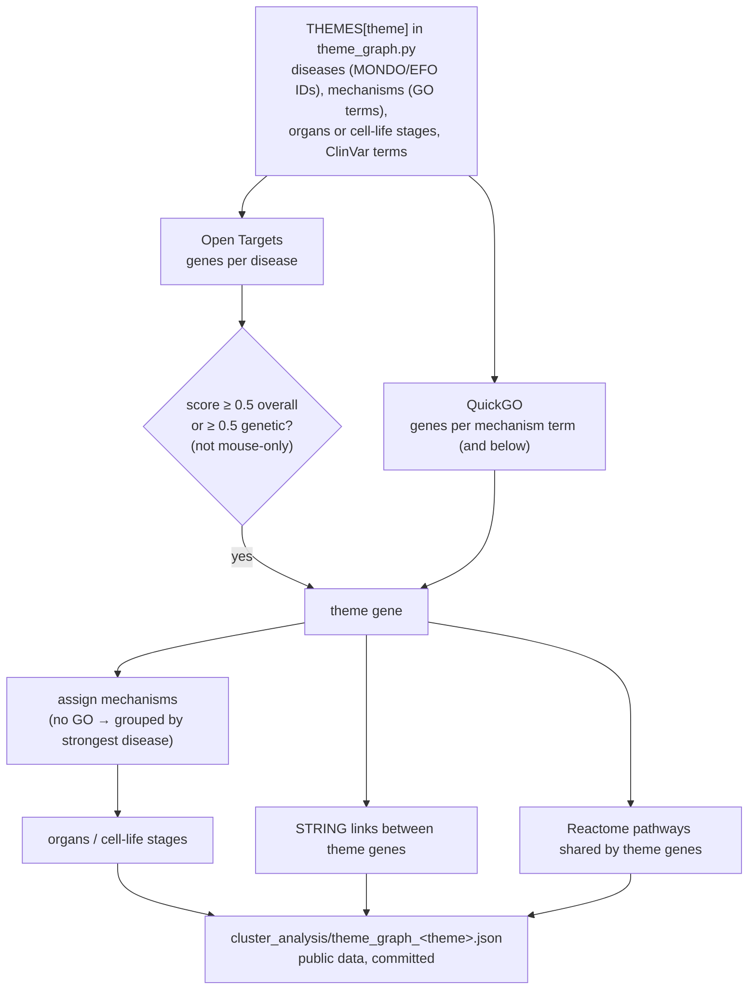
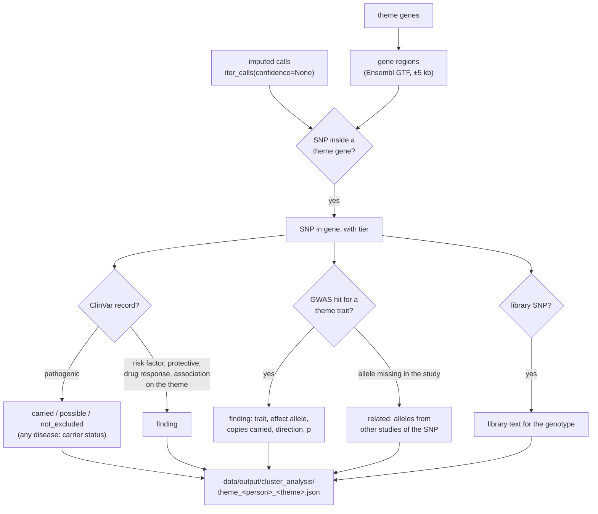
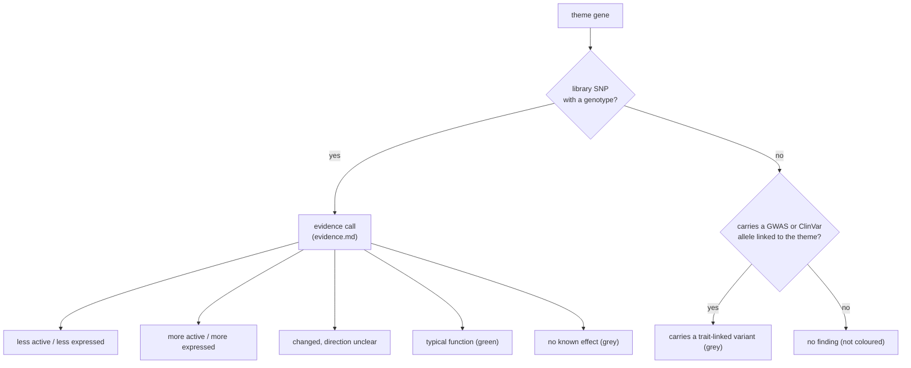

# Themes and the DNA cross-reference

A theme (cancer and senescence, female fertility, male fertility, muscle growth) is a graph of genes grouped by
mechanism. The graph is built from public data without looking at anyone's DNA; the person's calls are laid over it
afterwards, offline.

## Two kinds of theme

| Theme | Built by | Genes from | Person |
|---|---|---|---|
| Cancer and senescence | `theme_graph.py` | Open Targets + GO | XY |
| Female fertility | `theme_graph.py` | Open Targets + GO | XX |
| Male fertility | `theme_graph.py` | Open Targets + GO | XY |
| Muscle growth | `themes.py` | The library's genes, matched to facets by GO, Reactome, UniProt and GWAS text | XY |

## Building an API theme

## Cross-referencing the person

ClinVar alleles are compared forward strand to forward strand, never flipped: one position can hold a benign and a
pathogenic change (APC rs2229992), and flipping would invent a pathogenic allele.

## What a gene's colour means

Two things to keep in mind when reading the colours:

- **Less or more active is not good or bad.** It describes the gene. A less active tumour suppressor is a risk; a less
  active PCSK9 lowers cholesterol. Whether a change helps or harms depends on the gene's role.
- **"Carries a trait-linked variant" is weak information.** The gene is outside the library, and the person carries at
  least one allele that a genome-wide study linked to a theme trait. Each such allele shifts risk by a few percent, many
  are common, and the label doesn't yet say whether the carried allele raises or lowers the trait. The direction is
  stored per finding (`direction`: raises / lowers) but not yet used for the colour.

## Outputs per theme

| Dataset | One row per | Holds genotypes |
|---|---|---|
| `theme_meta` | theme and mechanism | Counts only |
| `theme_genes` | theme and gene | Yes |
| `theme_links` | interacting gene pair | No |
| `theme_pathways` | shared pathway | No |

## Female fertility in depth

The female fertility theme has a card in two parts under its 28-day cycle; a phase band or heading in the cycle chart
opens it at that phase's section. `cluster_analysis/themes/fertility_deep.py` builds it for each female profile in the
`genes` step of `profiles.py run` (after the gene calls, which it reads), into `profiles/<id>/`: `fd_explain.json` and
`fd_genes.json` (public), `fd_impact.json` and `fd_phases.json` (personal). The export makes them datasets of the same
names; `explorer/fd.js` draws them. `themes/fertility_deep.json` only chooses: sections, their GO processes and Reactome
reactions, genes, the studied variants with their studies (anchors and number patterns), the GWAS studies, the tissues
for eQTLs, and which molecules are drawn as cofactors.

**Part 1, how the cycle works** (the same for everyone), eight sections: the hypothalamus–pituitary–ovary axis, follicle
development, steroid making in theca and granulosa cells, ovulation, corpus luteum and luteolysis, endometrium and
implantation, menstruation, and a reproductive life.

| Part | Source |
|---|---|
| What a process is | Gene Ontology definitions (QuickGO), and the human genes annotated to it |
| Each step | a Reactome reaction: inputs and outputs (cofactors marked), catalyst, genes, compartments, summary |
| What a gene does, where in the cell, cofactors | UniProt (reviewed human entry) |
| The axis and the two-cell model | schematics (labelled so), whose nodes are the Reactome reactions above |
| The cycle chart's phase texts and tooltips | Gene Ontology definitions; the hormone curves are a labelled schematic |

**Part 2, what the person's variants change**: every gene of a section (its reactions' genes, its chosen genes and the GO
process genes) with the person's evidence, ranked per section:

| Grade | Evidence |
|---|---|
| Measured (A) | a study that measured the form in women (the size read from its abstract: FSHR Ser680/Ser680 +2.3 days from luteolysis to ovulation, +31% FSH ...); a measured or CPIC protein effect from the gene calls |
| Associated (B) | a genome-wide reproductive GWAS hit (GWAS Catalog, per copy); an independent eQTL in ovary, uterus, pituitary, hypothalamus or vagina (GTEx NES per copy); a curated protein effect |
| Predicted (C) | a predicted protein effect from the gene calls |

Each gene links to its steps in Part 1; genes without evidence are listed as such. The section's forms measured in
women, the GWAS trait panels (lead variants scored against Europeans) and, for a reproductive life, premature ovarian
insufficiency (ClinVar records the file can check, MedGen's definition) follow, from `fd_phases`.
