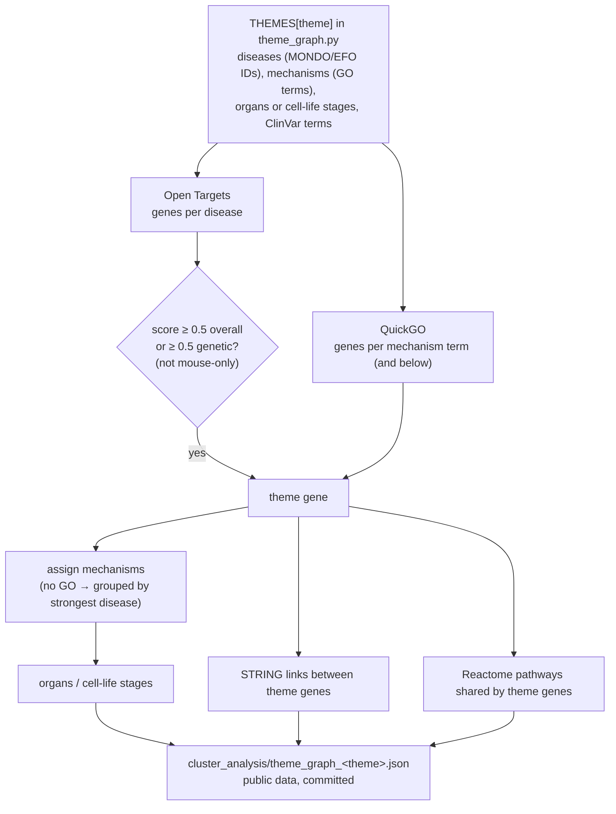
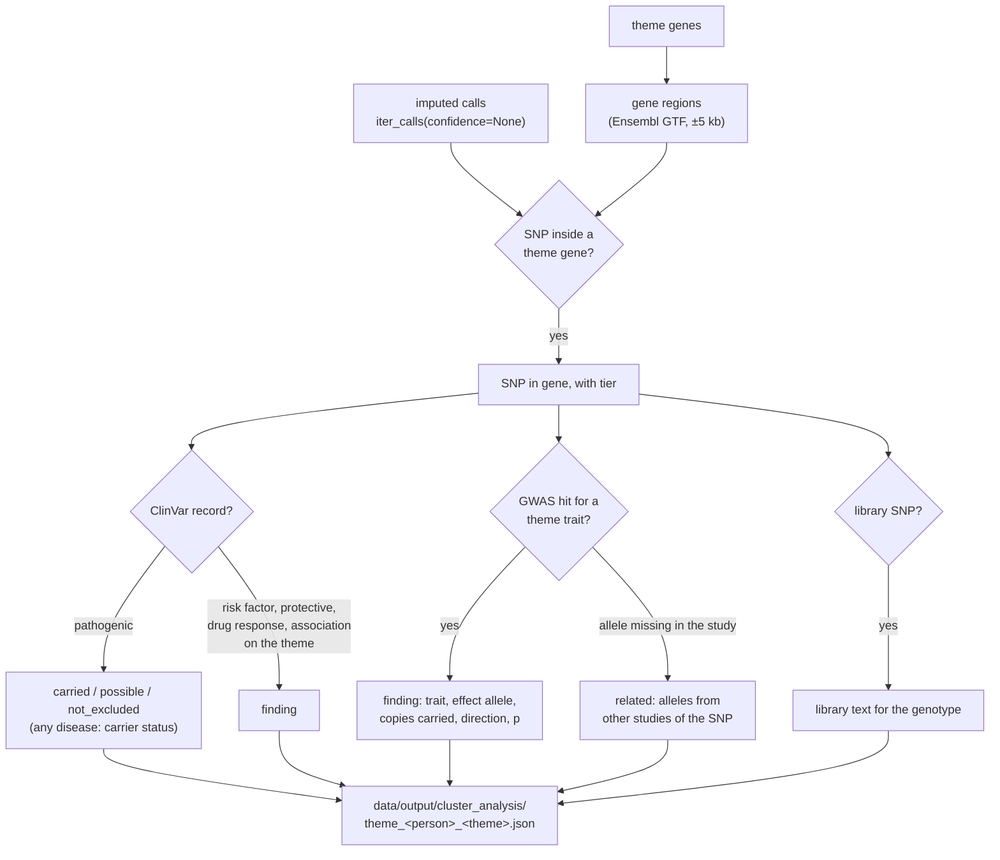
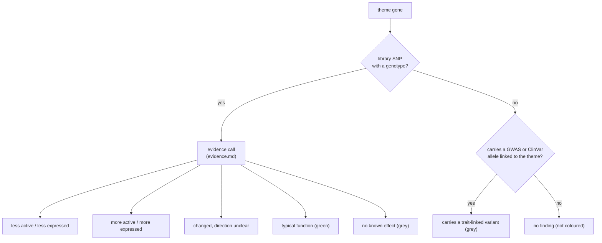

# Themes and the DNA cross-reference

A theme (cancer and the life of a cell, female fertility, male fertility, muscle growth) is a graph of genes grouped by
mechanism. The graph is built from public data without looking at anyone's DNA; the person's calls are laid over it
afterwards, offline.

## Two kinds of theme

| Theme | Built by | Genes from | Person |
|---|---|---|---|
| Cancer and the life of a cell | `theme_graph.py` | Open Targets + GO | XY |
| Female fertility | `theme_graph.py` | Open Targets + GO | XX |
| Male fertility | `theme_graph.py` | Open Targets + GO | XY |
| Muscle growth | `themes.py` | The library's genes, matched to facets by GO, Reactome, UniProt and GWAS text | XY |

## Building an API theme

## Cross-referencing the person

ClinVar alleles are compared forward strand to forward strand, never flipped: one position can hold a benign and a
pathogenic change (APC rs2229992), and flipping would invent a pathogenic allele.

## What a gene's colour means

Two things to keep in mind when reading the colours:

- **Less or more active is not good or bad.** It describes the gene. A less active tumour suppressor is a risk; a less
  active PCSK9 lowers cholesterol. Whether a change helps or harms depends on the gene's role.
- **"Carries a trait-linked variant" is weak information.** The gene is outside the library, and the person carries at
  least one allele that a genome-wide study linked to a theme trait. Each such allele shifts risk by a few percent, many
  are common, and the label doesn't yet say whether the carried allele raises or lowers the trait. The direction is
  stored per finding (`direction`: raises / lowers) but not yet used for the colour.

## Outputs per theme

| Dataset | One row per | Holds genotypes |
|---|---|---|
| `theme_meta` | theme and mechanism | Counts only |
| `theme_genes` | theme and gene | Yes |
| `theme_links` | interacting gene pair | No |
| `theme_pathways` | shared pathway | No |
